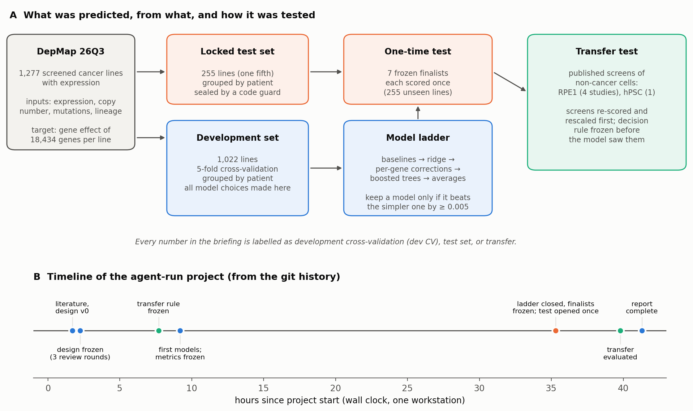
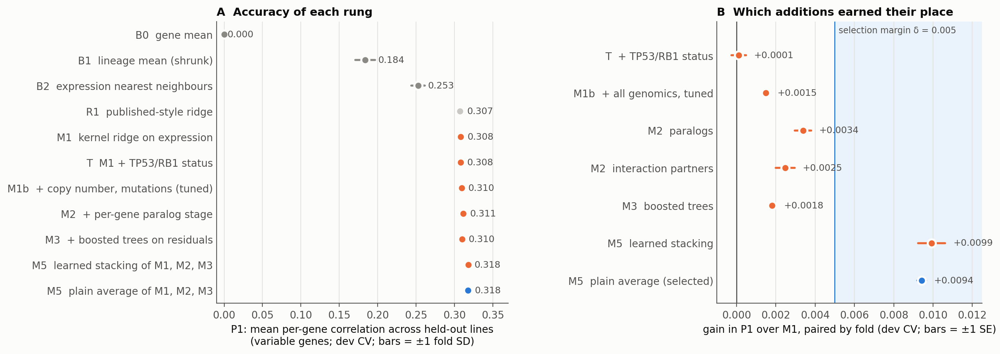
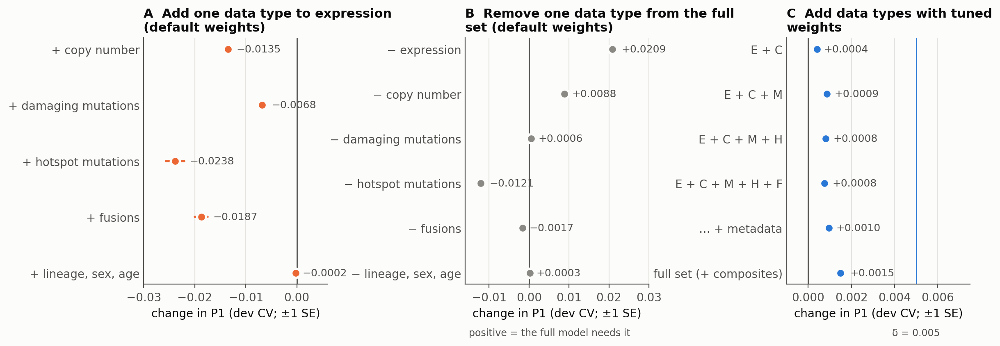
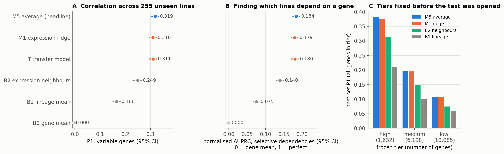
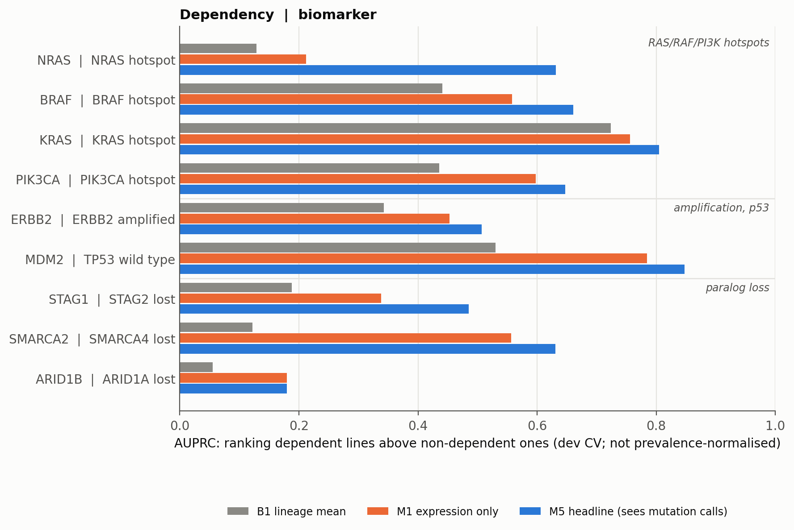
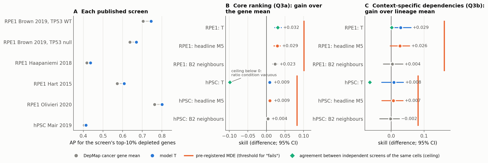
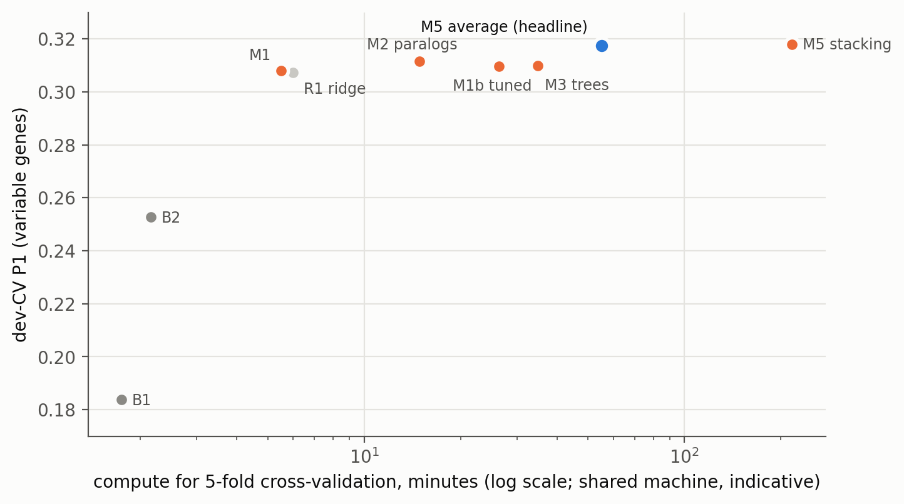

# Can we predict which genes a cell needs without screening it? An AI-run study on DepMap, and what it says about agentic science

*Research briefing. It was written by the AI agent (Claude Opus 5.5) that acted as principal investigator (PI) of
this project; see the human-written disclaimer in [README.md](README.md). No human has yet verified the results.
The full technical account, with every number traced to a results file, is [REPORT.md](REPORT.md). Every number in
this briefing comes from that report or its results files, and the text says where each was measured: during
model development (**dev CV**), on the sealed **test set**, or on **non-cancer cells** (transfer).*

---

## At a glance

- **The question.** A CRISPR knockout screen tells you which genes a cell line needs to grow. Many cell lines
  and almost all non-cancer cell types have been profiled (for example, their gene expression has been
  measured) but never screened. Can the profile predict the screen?
- **The answer for cancer lines: partly, and mostly from gene expression.** On 255 cancer lines that no model had
  seen, the best model's predictions correlated with the measured gene effects at r = 0.319 on average across the
  genes that vary between lines. A baseline that knows only each line's tissue of origin reaches 0.166.
- **Simple won.** A regularised linear regression on expression (ridge regression) got almost all of the way. Copy
  number, mutations, a neural network, per-gene feature selection and elastic nets added little or nothing. The final
  model averages the ridge with two small corrective models; it adds +0.009 in correlation, a small gain, but one
  that replicated on the test set. (The neural network was tried only as a cheap pre-check, and failed it.)
- **One clear blind spot.** Expression cannot see point mutations. Within a tissue, an expression-only model
  barely tells NRAS-mutant lines that depend on NRAS from the rest; BRAF and KRAS dependencies are found mostly
  through tissue. The final model reads mutation calls and recovers most of this, but only when those calls are
  supplied to it.
- **Beyond cancer, the signal is weak.** In published screens of non-cancer cells (a retinal epithelial line, RPE1,
  and embryonic stem cells), the model ranked the most essential genes only slightly better than DepMap's average
  over all cancer lines (about 5% relative in RPE1, 2% in the single stem-cell screen). Context-specific needs were
  not detectable. The external screens disagree with each other about as much as any signal we could hope to find.
- **As agentic science.** An AI PI planned, delegated, reviewed and wrote up the project in about 41 hours of wall
  clock on one workstation, with AI reviewers at each major stage. The safeguards that were enforced by code worked.
  Several that existed only as written promises lapsed, and are disclosed.

---

## Key terms

| Term | Meaning in this briefing |
|---|---|
| **CRISPR knockout screen** | An experiment that disrupts each gene in a population of cells, one gene per cell, and measures which disruptions make cells drop out as they grow. |
| **Gene effect** | DepMap's score for how much a line needs a gene, computed by the Chronos method. 0 is no effect; −1 is the typical effect of knocking out a gene every cell needs. More negative means more needed. |
| **Dependency / essential** | A gene a line needs. Here a gene counts as essential in a line when its gene effect is below −0.5. **Common essentials** are needed by nearly every line; **selective dependencies** only by some. |
| **DepMap** | The Cancer Dependency Map, which has screened over a thousand cancer cell lines and profiled them molecularly. We used its 26Q3 public release. |
| **Cell line, lineage** | A cell line is a cell population grown in the lab from one tumour or tissue. Its lineage is the tissue of origin (lung, blood, skin, …). |
| **Expression** | How strongly each gene is transcribed into RNA (from RNA sequencing). |
| **Variable genes** | The 2,118 genes whose effect varies between lines (standard deviation above 0.25). For other genes, every line behaves about the same. |
| **Cross-validation (CV)** | Training on part of the data and scoring on the rest, rotated five times so every development line is scored once by a model that never saw it. |
| **Agent, subagent** | An AI model working with tools (code, files, the web) on a task. The PI agent delegated tasks to subagents and reviewed their output. |

---

## 1. Why this problem matters

Cancer cells often depend on genes that normal cells can do without. Some of these dependencies follow from the
cancer's own alterations: a cell driven by a mutant oncogene may need that oncogene, and a cell that has lost one
copy of a gene pair may need the other copy (its paralog). Finding such dependencies is a route to drug targets.
CRISPR screens find them directly, but each screen is an experiment of weeks. DepMap has screened over a thousand
cancer lines. Many more lines, and most normal cell types, have only been profiled.

A model that predicts a line's gene effects from its profile would let a researcher ask which dependencies an
unscreened line probably has, and how far to trust each prediction. The task given to the agent (PROMPT.md) had
two parts:
1. Build and benchmark such a predictor for a cancer line that has been profiled but never screened, test which
   data types help, compare it with simple baselines, and report its runtime.
2. Test whether a model trained on cancer lines works on non-cancer cells, after correcting for the technical
   differences between screens from different labs.

---

## 2. How the project was run: an exercise in agentic science

The project was run by one AI agent acting as PI, which delegated work to other agents (literature surveys,
coding, model runs, independent reviews) and made the decisions. A human set the task, downloaded the DepMap files
(the DepMap portal blocks automated downloads, and the agent was told not to get around such checks), and later
asked for two extra analyses during the project. After the report was final, the human also supplied DepMap's
screen maps and asked for the prediction script to accept mutation and copy-number data (sections 7 and 11).
Otherwise the work ran without human intervention.

*Figure 1. (A) The study design. One fifth of the cancer lines were locked away as a test set before any modelling.
Every modelling choice was made by cross-validation on the remaining development lines. Seven frozen finalists
were scored on the test set once, and a frozen transfer rule was then applied to published screens of non-cancer
cells. (B) Timeline from the git history: about 41 hours from the first commit to the finished report.*

**The process had four main safeguards.**
- **Design by critique.** The agent surveyed the literature (LITERATURE.md) and drafted a design (DESIGN.md).
  The draft went through three review rounds. In round 1, seven reviewer agents each took one angle: prior work,
  statistics, data, algorithms and compute, biology, typical failure modes of AI agents, and an "external PI".
  The design was frozen about two and a quarter hours after the start.
- **Pre-registration.** Metrics, baselines, the rule for choosing a model, and the rule for judging transfer were
  written down and frozen in git *before* the data they apply to were looked at. There were exceptions, all
  logged and disclosed. The replicate ceilings in the transfer rule were computed from aggregate reads of the
  external screens before the rule was finalised. One change to the "fails" rule was missing from the decision
  notes.
- **A code guard.** A small piece of code refused to hand test-set or external-screen data to any model that was
  not on a committed finalists list. It also required an explicit unblinding flag and logged every access.
- **Independent checks.** At four points (evaluation code, first models, test set, transfer) an agent that had not
  produced the result re-implemented the key calculations in its own code and looked for leakage. All of the
  nearly 600 test-set and transfer values compared were reproduced, with differences only at rounding level.

The agent also kept a research tree (RESEARCH_TREE.md) with more than 30 numbered decisions, a log of 124 registered model
runs, and a list of process lessons (LESSONS.md). Section 10 discusses what worked and what did not.

---

## 3. Building a fair benchmark

Most of the effort in a prediction study goes into making sure the reported accuracy is not flattered. Each
choice below closes a specific loophole.

### 3.1 The data
DepMap 26Q3 has gene effects for 1,361 cell lines and 18,434 genes. We kept the 1,277 screened cancer lines that
also have expression data. As inputs, a model could use:
- expression of about 18,000 protein-coding genes;
- copy number (how many copies of each gene a line carries);
- damaging mutations, hotspot mutations (recurrent cancer-driving mutations) and gene fusions;
- metadata (lineage, sex, age).

Other DepMap data types (methylation, mass-spectrometry proteomics, metabolomics) need a manual portal download
and were not available, so they were not tested. One published proteomics data set was tested on a 253-line subset.

**What was off limits.** No CRISPR or RNAi data from evaluation lines could be used as input. Networks built from
co-essentiality across screens were excluded because they partly encode the answer, and text-mined gene networks
such as STRING were excluded as instructed.

### 3.2 A test set locked before any modelling
On day one, before any model existed, 255 lines (one fifth) were drawn as the test set and committed to git.
- **Grouped by patient.** 104 screened lines share a donor with another line. Lines from the same patient were
  kept on the same side of the split, so a model cannot score well by recognising a sibling line.
- **Stratified by lineage.** The test set has the same mix of tissues as the rest.
- **Development lines.** The other 1,022 lines were split into five folds, also grouped by patient, and every
  model choice was made by cross-validation within them.

### 3.3 What "accurate" means here
A prediction can look good for the wrong reason. Some genes are needed by every line, so simply predicting each
gene's average effect already gets the overall pattern right. The useful question is whether the model knows
which lines need a gene more than others. The metrics were chosen to ask exactly that.

- **P1 (primary): per-gene correlation across lines.** For each gene, take the held-out lines and correlate the
  predicted effects with the measured ones (Pearson r). Average over the 2,118 variable genes. A model that only
  knows each gene's average scores 0 by construction.
  - **Per fold, not pooled.** P1 is computed within each held-out fold and then averaged. Pooling the folds would
    give the gene-average baseline a spurious negative score, because each fold's average differs slightly.
- **P2a: per-line essentiality ranking.** Within each line, rank all genes by predicted effect and measure how well
  the essential ones (effect below −0.5) come first, as average precision (AP). AP summarises the area under the
  precision-recall curve, the "AUPRC" the task asked for.
- **P2b: finding the dependent lines for selective genes.** For each gene that some but not all lines need, rank
  the lines by predicted effect and measure AP. It is normalised so that 0 means no better than a random ranking
  (AP equal to the fraction of dependent lines) and 1 means perfect. This is the hardest metric, and the one closest to the user's real question.

### 3.4 Baselines, and the rule for choosing a model
Three baselines set the bar:
- **B0, gene mean:** each gene's average effect over training lines.
- **B1, lineage mean:** each gene's average effect within the line's tissue, shrunk toward the overall mean when a
  tissue has few lines.
- **B2, nearest neighbours:** the average effect in the 20 or so training lines whose expression is most similar.

**Selection rule.** A more complex model replaced a simpler one only if it raised P1 by more than **δ = 0.005**
and by more than one standard error across folds. The rule, fixed in advance, protects against picking a model
that won by chance among many tries. Exactly one headline model had to be named before the test set was opened.

---

## 4. Training models: a ladder from simple to complex

Models were tried in order of complexity, each one having to beat the current best (Figure 2).

*Figure 2. Development cross-validation (1,022 lines, 5 folds). (A) P1 for each baseline and model. (B) Paired gain
over the expression ridge M1. Only the combinations of models clear the pre-set margin δ.*

**The baselines.** Knowing the tissue (B1) gives P1 = 0.184, and finding the most similar lines by expression (B2)
gives 0.253. So expression carries information beyond tissue.

**M1: ridge regression on expression.** Ridge regression is linear regression with a penalty that shrinks all
coefficients toward zero. That suits a problem with about 18,000 inputs and about 800 training lines. All genes
are predicted at once, sharing one penalty per group of genes, which keeps the fit fast (minutes).
- **Score:** dev-CV P1 = 0.308.
- **Target change.** The pre-registered target was each line's deviation from the lineage mean (B1). Predicting
  the deviation from the overall gene mean instead was better by 0.008, which clears the rule. The switch was made
  with the test set still sealed, and is recorded.
- **Equal to a published ridge.** M1 then matched a published-style ridge regression (R1, 0.307), as expected
  from the literature (section 10).

**M1b: adding copy number, mutations, fusions and metadata.** Section 5 describes this. In short, the gain is real
but tiny (+0.0015 at most).

**M2: a per-gene correction using paralogs.** For each variable gene, a second small ridge model adjusts M1's
prediction. It uses the gene's own expression, copy number and mutation status, plus the same information for its
three closest paralogs.
- **Why paralogs:** a gene whose paralog is lost or silenced often becomes essential (paralog buffering).
- **Result:** paralogs gave the largest correction (+0.0034). Physical interaction partners gave less (+0.0025).
  Neither cleared δ.

**M3: boosted decision trees on M1's errors.** Gradient-boosted trees (LightGBM) were trained per variable gene on
what M1 got wrong. Trees can capture thresholds and interactions that a linear model misses, such as "dependent
only if this hotspot is mutated and the line is a melanoma".
- **Inputs:** expression, copy number, mutation, hotspot and lineage features.
- **Result:** +0.0018, below δ.
- **A leak caught in review.** The original version had a subtle leak in its early-stopping step: the data used to
  decide when to stop training had indirectly seen the validation lines. The leaky version scored +0.0043. The
  fixed version is the one reported.

**M4: a neural network** was tested first in a cheap pre-registered check on one fold. On 256 principal components
of expression, five neural-network seeds scored P1 0.302–0.304, all below ridge regression on the same components
(0.307). M4 was not built further.

**M5: combining M1, M2 and M3.** The pre-registered plan was a learned weighting ("stacking"). It had to beat a
plain average to be used, and it did not (+0.0005, within noise). The **plain average of M1, M2 and M3** gained
+0.0094 over M1, in 5 of 5 folds, which clears the rule. It became the headline model (dev-CV P1 = 0.3175).

**Why does averaging help when neither correction helps alone?** A post-hoc scan of the stored predictions showed
that the M2 and M3 corrections each overshoot by about a factor of two. The average applies one third of each, which
works as shrinkage. Tuning that factor now would be fitting to results already seen, so it was left as future
work. The headline therefore rests on two corrections that each failed the bar alone and passed only together.
The test set (section 6) confirmed the gain, but this should be kept in mind.

**Published methods re-run on the same folds:**
- an elastic net (as in Shi et al. 2024) scored 0.030 below M1 on the 150 genes it could afford to run;
- per-gene feature selection (TrPLet-like) scored 0.038 below M1 on 500 genes. That gap is an upper bound: when
  allowed to keep more features, the method moved toward dense ridge and closed much of it. Selecting a few
  features per gene bought nothing over shrinkage;
- a version that chose the best of 12 settings per gene inside the same cross-validation it was scored on did
  better than the properly nested version. Such selection inflates scores, and some published numbers were
  obtained that way, but this comparison does not measure by how much.

**Unseen tissues.** Leaving out one whole lineage at a time (18 lineages with at least 20 lines), M1 still reached
P1 = 0.203 on the unseen lineage and beat nearest neighbours in all 18. A new tissue costs some skill, not all of
it. The final average was not run on this split.

---

## 5. Which data types help?

The task asked for an ablation: adding and removing data types to see which matter. The first answer was
misleading, and the way it was corrected is one of the more useful lessons of the project (Figure 3).

*Figure 3. Dev CV. (A) Adding one genomic data type to expression with default weights made the model worse
(metadata, the last row, had no effect).
(B) Removing data types from the full model shows that copy number does carry signal. (C) With tuned weights, every
combination helps, but by far less than the selection margin.*

1. **The first result: everything hurt.** With default settings, each data type got equal total weight in the
   model. Under that scheme, adding copy number, mutations, hotspots or fusions to expression lowered P1 in every
   fold (by up to 0.024). A naive reading would be "genomics makes predictions worse".
2. **A second view disagreed.** Removing each data type from the full model instead showed that the model needs
   expression (+0.021) and copy number (+0.009). The two views conflict.
3. **The explanation was weighting.** Equal weight per data type puts a few dozen hotspot or fusion columns on the
   same footing as about 18,000 expression genes, so the noise drowns the signal. The design had anticipated this.
   No negative claim was made until the weights had been tuned.
4. **With tuned weights, every combination helped, but slightly.** Tuning down-weighted genomics 16- to 64-fold. The
   gains then ranged from +0.0004 (adding copy number) to +0.0015 (everything), consistent in every fold, but far
   below δ.

**Conclusion.** For a linear model that already has expression, genomics adds no gain worth its complexity. That
is "no selectable gain", not "no signal". The one place genomics matters a lot is shown in section 7.

**Two further checks on the data:**
- *Provenance metadata:* how a line was grown and what kind of model it is improved P1 by 0.014. But it largely
  identifies the screening batch rather than biology, so it was excluded, as pre-registered.
- *Proteomics:* adding protein abundance on the 253-line subset did not help (−0.006).

---

## 6. Is the skill real? Controls, and the one-time test

### 6.1 Controls during development
A correlation of 0.3 could come from technical structure rather than biology. Three checks addressed this.
- **Lineage.** Lines of the same tissue resemble each other in both expression and dependencies. P1 was recomputed
  after subtracting each lineage's average from both predictions and measurements. M1 kept most of its skill
  (0.245 within lineage, dev CV), so it predicts differences between lines of the same tissue.
- **Screening library.** DepMap screened lines with different guide libraries and screen lengths, which leave
  technical fingerprints. P1 within library groups was 0.279 for M1, and 0.199 within lineage × library cells.
  - A control that shuffled expression within lineage × library cells scored −0.007 there. So the skill that
    survives within those cells is not explained by tissue or library.
  - Part of the within-lineage skill *is* explained by library, though. Shuffling expression within lineage ×
    library cells still left a within-lineage score of 0.071.
- **Shuffled data.** Shuffling the data between lines removed the skill (P1 0.003), as it should.

Two of these controls missed the ranges stated for them in advance. Shuffling expression within lineage removed
the within-lineage skill as intended, but its overall P1 (0.127) fell below its expected band, the conservative
direction. The lineage × library shuffle kept more within-lineage skill (0.071) than its bound allowed. The bounds
had been set without simulating the controls; the misses were interpreted and disclosed, not re-run with new
bounds.

### 6.2 The test set, opened once
Seven finalists were frozen in git: the headline average, the expression ridge, the transfer model T (section 8),
T trained without embryonal carcinoma lines, and the three baselines. Each was then refit on all 1,022
development lines and scored on the 255 test lines exactly once (Figure 4).

*Figure 4. Test set (255 lines never used in development). (A) P1 with 95% confidence intervals from resampling
patients. (B) Normalised AUPRC for selective dependencies. (C) P1 by per-gene predictability tier; tiers were fixed
from development results before the test set was opened.*

- **The headline replicated.** Test P1 = 0.319 (95% CI 0.304–0.333), against 0.3175 in development.
  - It beat the lineage mean on 96% of variable genes.
  - The gain over the expression ridge was +0.0093 (CI 0.0085–0.0100), the same as in development. The headline
    was better on 70% of variable genes.
  - The gain is confined to variable genes: on the other 16,275 genes the two models make identical predictions.
- **Skill within tissue and library held** (test): within library 0.303, within lineage 0.270, within lineage ×
  library 0.225.
- **Essentiality ranking within a line (P2a) is easy, and that is the point.** The gene mean alone reaches AP
  0.905, against 0.915 for the headline. The genes a line needs are mostly the genes every line needs. A model
  should not be credited for this.
- **Finding the dependent lines for selective genes (P2b) is hard.** The headline's normalised AUPRC was 0.184,
  against 0.075 for the lineage mean and 0.140 for nearest neighbours. This is real but modest skill.
  - Its AUROC was 0.663, the chance that a dependent line is ranked above a non-dependent one.

### 6.3 Telling users which predictions to trust
Mean accuracy hides the fact that some genes are predicted well and most are not. At a user's request, the agent
added per-gene **predictability tiers** from the development results:
- **high:** mean r across folds at least 0.30, and at least 0.20 in every fold;
- **medium:** mean r at least 0.15, and positive in every fold;
- **low:** everything else.

A null model scored on shuffled data produced no high-tier genes.

| Tier | Genes | Test-set P1 (headline) |
|---|---|---|
| High | 1,632 | 0.383 |
| Medium | 6,198 | 0.196 |
| Low | 10,085 | 0.106 |

The tiers were frozen before the test set was opened, and they separate genes on unseen lines (Figure 4C). Across
genes, development accuracy and test accuracy correlated at Spearman 0.65 overall and 0.82 among variable genes.
High-tier genes were predicted more than three times as well as low-tier genes on the test set. Every
prediction the tool outputs carries its tier and a confidence score.

**What makes a gene predictable.**
- **High-tier genes vary more between lines.** Their effect spread across lines is wider than that of low-tier genes.
- **They are measured more reproducibly.** Their lineage averages agree better between independent screening
  libraries.
- **What they are:** they are enriched in proliferation, translation, mitochondrial and p53 programmes.
- **Many low-tier genes are partly limited by measurement noise,** not only by the model.

---

## 7. What expression cannot see: mutation-driven dependencies

Expression-first models have a known weak spot. A point mutation in an oncogene can make a line dependent on that
gene without changing how much RNA it makes. At the user's request, the agent pre-registered 19 biomarker–dependency
pairs, a metric, and a rule for when genomics "clearly helps", before computing any pair-level number. One caveat:
earlier results had already hinted at the NRAS result.

*Figure 5. Dev CV. How well each model ranks lines that depend on a gene above lines that do not, for biomarker
pairs (dependency | biomarker); 9 of the 19 pre-registered pairs are shown. This AUPRC is not normalised for how
common the dependency is.*

The pattern is specific:
- **Amplifications and the p53 axis are already visible in expression.** An amplified ERBB2, CCND1 or MYC is
  over-expressed. MDM2 dependency in TP53 wild-type lines is read out through p53 target genes. Adding genomic
  status changed little.
- **Paralog-loss dependencies are hard.** Examples are ARID1B after ARID1A loss (AUPRC 0.180 for the expression
  ridge) and STAG1 after STAG2 loss (0.338). Adding the genomic status to the ridge did not help (STAG1 0.349). The
  headline average does better on STAG1 (0.485) and SMARCA2 (0.631, from 0.556), through its paralog and tree
  stages, but not on ARID1B, and these values remain modest.
- **RAS/RAF hotspot addiction is the blind spot.** For NRAS dependency in NRAS-mutant lines, the expression ridge
  reached AUPRC 0.212. The tree model, which sees hotspot calls, reached 0.657, and the headline average 0.631. BRAF
  improved from 0.558 to 0.661 and KRAS from 0.756 to 0.805.

The pre-registered rule required clear gains in at least three pairs. Only NRAS qualified, so no dedicated
genomics model was built.

**The practical consequence for users** surfaced late, in a red-team review of the report. The prediction script
as first released passed only expression to the headline model, with all genomic inputs set to "wild type".
- **Evaluated that way afterwards** (dev CV, post hoc), the headline scored P1 0.3135, and its NRAS AUPRC fell back
  to 0.219. That still cleared the rule for keeping it as the default, but only by 0.0004, and this configuration
  has no test-set number.
- **A later update, at the user's request,** lets users supply DepMap-format copy-number and mutation tables. With them, the script
  reproduced the evaluated headline's development predictions to within 2.4 × 10⁻⁷. Genomic calls from other
  pipelines have not been tested.

---

## 8. Beyond cancer: do the predictions transfer to non-cancer cells?

### 8.1 Why this is hard
Every training line is a cancer line. Non-cancer cells differ biologically: they have intact p53 signalling,
normal chromosome numbers and different tissue programmes. The published screens also differ technically from
DepMap's:
- they used other guide libraries (TKOv1–v3, Brunello) and other screen lengths;
- they were scored with other methods;
- their expression was measured in other labs.

The task asked that these batch effects be corrected before concluding that the model fails.

### 8.2 What was assembled
- **Screens:** 16 non-transformed screens from original deposits, 12 of them with raw guide counts.
- **Anchors:** 8 sets of screens that external labs ran on DepMap cancer lines. These are the same lines in both
  pipelines, so they show what a perfect model would look like after harmonisation.
- **Expression:** 9 external expression sources.

**What survived quality control.** A screen passed QC only if it clearly separated known essential genes from known
non-essential genes.
- **Evaluated:** hTERT-RPE1 (a telomerase-immortalised retinal epithelial line; 4 independent studies) and one
  human embryonic stem cell (hPSC) screen.
- **Lost to QC:** the primary T-cell screens.
- **Not run:** the iPSC-derived neuron and microglia screens use CRISPR interference rather than knockout. They
  could not be compared without an anchor that was never obtained, so they were not evaluated.
- **Coverage gap:** the task named iPSC, iPSC-derived and primary blood cells explicitly. None of them could be
  evaluated.

### 8.3 Harmonisation and the decision rule, frozen before any model was applied
- **Screens:**
  - Guide counts were re-scored as log-fold changes.
  - Each screen was rescaled so that half of a standard list of core-essential genes sat at DepMap's typical
    essential value and half of the non-essential genes at zero. The other halves were kept for evaluation.
  - A gene-wise correction learned from the anchors was tested. It did not improve agreement, so it was not applied.
- **Expression:** external RNA-seq was converted to DepMap's units and quantile-normalised to the DepMap
  distribution.
  - For RPE1, DepMap's own expression profiles of RPE1 sublines were used, so the RPE1 result tests transfer across
    screens, not across expression batches.
- **The model.** Transfer used model **T**: the expression ridge plus TP53 and RB1 status flags. It omits lineage,
  which has no meaning for these cells. On cancer test lines T matched the ridge (test P1 0.311).

**Two questions, each with a rule fixed in advance:**
- **Q3a, core ranking.** Does T rank each screen's top 10% most-depleted genes better than DepMap's cancer gene
  average does? This measures improvement beyond "essential genes are essential everywhere".
- **Q3b, context-specific dependencies.** Does T recover genes that the screened cells need but most cancer lines
  do not, better than the nearest lineage's average?

**Verdicts.** The unit of evidence was the study, with uncertainty from resampling studies and gene families.
- **"Transfers":** the confidence interval excludes zero, and the effect is at least half of what independent
  screens of the same cells achieve (the "replicate ceiling").
- **"Fails":** the whole confidence interval lies below a pre-set threshold, the minimum detectable effect (MDE),
  and at least one cancer anchor shows that the pipeline can detect skill. The MDE was set at twice the
  uncertainty of the replicate ceiling, so it is large when studies disagree.
- **"Inconclusive":** anything else.

### 8.4 Results

*Figure 6. Transfer to non-cancer cells. (A) For each screen, AP for its most depleted genes: DepMap's cancer gene
mean already gets most of the way, and T adds a little. (B, C) Skill over the comparator with 95% CIs, against the
pre-registered MDE (orange bar; the threshold for "fails") and the agreement between independent screens of the
same cells (green diamond).*

**Core essential genes transfer, in the trivial sense.** DepMap's cancer gene average alone ranks each RPE1
screen's most depleted genes with AP 0.42–0.76. Genes that every cancer line needs are mostly needed by RPE1 and
stem cells too.

**Q3a: model T adds a small, expression-specific gain.**
- **RPE1:** ΔAP = +0.032 (CI 0.022–0.040), about one twentieth relative, and positive in each of the 4 studies.
- **hPSC:** +0.009 (CI 0.004–0.014), from a single study.
- **Verdict:** both meet the pre-registered definition of "transfers". For hPSC this is weaker than it sounds:
  independent stem-cell screens agree with this screen *less* well than the cancer gene mean does (ceiling −0.098),
  so the "half the ceiling" condition is met trivially. The hPSC interval reflects gene sampling only, with no
  second study.
- **The gain needs the cells' own expression.** Feeding RPE1 screens the stem cells' expression removed the gain
  (−0.011 and −0.016). The gain also survived removing DepMap's common essential genes.

**Why "transfers" must be read narrowly:**
- **The gain is small next to the pre-set threshold.** The whole interval lies below the MDE (0.10 in RPE1). The
  MDE is this large because studies disagree. Had the study pool been held fixed, it would be 0.020, and the RPE1
  interval would not lie below it.
- **Independent screens agree no better.** Different labs' RPE1 screens predict one another with about the same
  skill (ceiling 0.031). The verdict says more about how noisy the external screens are than about the model.
- **Nearest neighbours do almost as well.** B2 also clears the same bar in RPE1 (+0.023, CI 0.016–0.030). So
  "transfers" does not show that T beats generic expression similarity.
- **The test has little demonstrated sensitivity.** On external screens of four cancer lines (the anchors), T
  showed no skill over the gene mean either, although these are lines like those it was trained on.
- **"Fails" was unreachable.** No cancer anchor screen showed positive skill in the external pipeline. HAP1, the
  only anchor screened with the TKOv3 library, scored −0.002. That made the test one-sided: it could say
  "transfers" or "inconclusive", never "fails". The agent forecast this in writing before the data were opened.
  - **Counterfactual:** had an anchor been positive, Q3a would have been "inconclusive" and Q3b "fails".

**Q3b: context-specific dependencies were not detectable.** RPE1 +0.029 (CI −0.003 to 0.061) and hPSC +0.008 (CI
−0.029 to 0.038), both "inconclusive".
- **Within DepMap they were detectable.** DepMap's own screens of five RPE1-derived lines, with no lab-to-lab
  difference, gave positive context-specific skill in all five lines (Δrecall 0.042–0.083). On core ranking these
  lines scored at a median 93rd percentile of the cancer test lines.
  - This analysis was descriptive, with no verdict. Its gene effects come from the same DepMap fit as the training
    lines, and it shares its expression input with the published-screen RPE1 analysis.
- **This points to the external screens, rather than the cell type, as the main limit,** though it does not prove
  it. Two of the noisiest screens also labelled over 3,500 genes as "specific", so much of what Q3b scored there
  was noise.

**A pluripotency failure, forecast in advance.** Stem cells need pluripotency factors (SOX2, PRDM14, NANOG,
LIN28A); the hPSC screen measured SOX2 at −1.61. T predicted none of them (SOX2 −0.16).
- Only four embryonal carcinoma lines in the training data share this biology. With so few examples, a
  regularised model shrinks rare dependencies to the average.
- The agent wrote this forecast down from development results before opening the stem-cell data.

**p53 checks passed, but they are not transfer evidence.** Flipping T's TP53 flag reproduced the direction of
isogenic p53 effects in RPE1 (Spearman 0.96 over 15 genes). This tests the TP53 feature, not transfer of
expression-based predictions.

---

## 9. Runtime alongside accuracy

*Figure 7. Development P1 against total compute for five-fold cross-validation (log scale). Timings come from a
machine shared with other jobs, so they are indicative only. The headline is placed at the sum of its three parts, which understates the cost of its paralog stage (that run
reused cached inner fits).*

Everything beyond ridge regression costs several to forty times more compute for gains of a hundredth of P1 or
less. Refitting on all development lines on a quiet machine took about 2 minutes for the expression ridge and about
27 minutes for the headline average, mostly the per-gene paralog stage. Once fitted, the ridge predicted all 255
test lines in under a second. Everything ran on one 12-core workstation without a GPU.

---

## 10. Where the ideas came from: credit to prior work

The final method is not new in its parts. Its components and its evaluation follow ideas from the literature the
agent surveyed (LITERATURE.md, with notes in `docs/lit/`). Some surveyed papers were found by search and not read
in full, and some survey notes are untagged and flagged as unverified; all are cited here only for the claims
the survey attributes to them.

| Idea used in the final method | Source | How it was used |
|---|---|---|
| Expression predicts dependencies better than genomic features | Dempster et al. 2020 (DepMap random-forest study); Shi et al. 2024 | Expression as the primary input; genomics tested as additions, not assumed |
| A plain multi-output ridge regression beat a published deep model (DeepDEP) on its own data | Chang & Zhang 2023 (re-analysis of Chiu et al. 2021) | Ridge as the first model rung, and the published-style ridge re-run as comparator R1 |
| Sparse linear (LASSO-type) regressors, on learned representations, top a recent benchmark; raw expression beats single-cell foundation-model embeddings | Bodinier et al. 2026 (LEAP); Zinchenko et al. 2025 | Motivated putting the neural rung behind a cheap pre-check; no embeddings in the headline |
| The best per-gene models are driven by the gene's own expression, its paralogs and lineage | Dempster et al. 2020; Shi et al. 2024 | Feature set of the per-gene stage M2 |
| Paralog buffering makes genes conditionally essential | De Kegel & Ryan 2019; Dede et al. 2020 | Top-3 paralogs (by Ensembl sequence identity) as M2 features; the variant kept in the headline |
| Nonlinear learners may catch thresholds and mutation × lineage interactions, at higher cost and for small gains | The survey's own recommendation; Dempster et al. 2020 found random forests close to elastic net | Gradient-boosted trees (LightGBM) on ridge residuals, M3 |
| Reported accuracy depends on gene set and pooling; best-of-N selection inside CV is optimistic | Survey of DeepDEP, Chang & Zhang, LEAP and TrPLet (Sadagopan et al. 2024/25) | Per-fold P1 on variable genes, nested selection, an explicit lineage baseline |
| Gene effects scored by Chronos; core-essential and non-essential reference genes | Dempster et al. 2021 (Chronos); Hart et al. 2015, 2017 and the Hart lab's reference sets | Target variable; screen rescaling and QC for transfer |
| Cross-study screens need anchor lines to harmonise | Dempster et al. 2019; Pacini et al. 2021 | Anchor screens of DepMap lines and the anchor gate in the transfer rule |
| Non-transformed screens in RPE1 and hPSC | Hart 2015; Brown 2019; Haapaniemi 2018; Olivieri 2020; Mair 2019; Ihry 2019; Yilmaz 2018 | Transfer data and replicate ceilings |

Two elements are the project's own: the finding that the two corrective stages help only when averaged, and the
pre-registered transfer rule with a replicate ceiling and an anchor gate. Neither is a methodological advance. (The
switch to predicting deviations from the gene mean, section 4, simply brought M1 into line with standard ridge
practice.) Our contribution is the combination: a patient-grouped,
pre-registered benchmark with an explicit lineage baseline, selective-dependency AUPRC, per-gene confidence that
holds on unseen lines, and a harmonised transfer test.

**How do our numbers compare?** Only loosely, because releases, line sets and splits differ.
- **On LEAP's 1,539 genes,** our mean per-gene Spearman (0.309 on the test set) sits slightly below LEAP's best.
- **On DeepDEP's 1,298 genes,** ours (0.293) is well above DeepDEP's published deep model and close to Chang & Zhang's
  ridge.
- **Against TrPLet,** ours is below its optimistically selected models.

---

## 11. Limitations, stated plainly

**Data and evaluation**
- **One screening technology, one release.** All training labels come from DepMap's pipeline. The test set shares
  that pipeline, so test accuracy says nothing about other labs' screens; section 8 shows how much that matters.
- **A shared fitting step.** DepMap's Chronos fit that produced test-line gene effects also saw the development
  lines. Its shared parameters are per gene, so per-gene correlations are barely affected, but the test set is not
  fully independent.
- **Screening library groups were inferred.** They came from patterns of missing values. DepMap's screen maps,
  supplied later, confirmed that the four main groups (94% of development lines) are single library combinations.
  "Library" here also tracks screen length (group medians from 14 to 24 days).
- **Modest accuracy.** P1 = 0.32 means most variation between lines is not predicted. Most genes fall in the low
  tier. Selective-dependency AUPRC (0.18 normalised) leaves many dependent lines unranked.

**Model selection**
- **A thin margin.** The headline won by averaging two corrections that each failed the selection rule alone. Its
  gain is small (+0.009), though it replicated.
- **Rare dependencies are lost.** Dependencies seen in only a handful of training lines are shrunk to the average:
  pluripotency genes, ALK, AR.

**Transfer**
- **Narrow coverage.** Transfer rests on RPE1 (4 studies) and a single stem-cell screen. No iPSC-derived or primary
  blood-cell screen could be evaluated.
- **A one-sided test.** "Fails" could not be reached because no anchor was informative.

**Process (the agentic part)**
- **Two promised records were never kept.** A running scope ledger and an implementation check of review items
  were required by the design but not kept. Both were reconstructed only at the end.
  - Of 174 accepted review items, 126 were implemented, 31 partly and 9 not; 8 were superseded.
  - Eight planned analyses have no recorded fate.
- **Mis-set control bounds.** Three controls missed bounds that had been mis-specified before the runs; they were
  interpreted and disclosed, not re-run.
- **Unplanned reads.** A few reads of protected data were not anticipated by the protocol. They are logged and
  disclosed in REPORT.md §4; none involved scoring model predictions.

---

## 12. Take-away messages

### For the bioinformatics question
1. **A linear model on expression is the right default.** It is fast, nearly as accurate as anything else tried,
   and robust on held-out lines. Claims of large gains from complex models should be checked against a
   properly tuned ridge on identical splits.
2. **Always report the lineage baseline.** Knowing the tissue alone gets about half of the headline correlation.
   Skill should also be shown within lineage and within screening batch.
3. **Measure the right thing.** Ranking essential genes within a line is nearly solved by the gene average. The
   informative question is which lines depend on a selective gene, and there the models are only modestly good.
4. **Genomics matters where expression is blind.** That means RAS/RAF hotspot addiction. Any tool built on this
   work should be given the line's mutation calls.
5. **Tell users which predictions to trust.** Per-gene tiers fixed in development separated good from poor genes
   on unseen lines: high-tier genes were predicted more than three times as well as low-tier genes.
6. **Transfer to normal cells is limited by data as much as by models.** Published non-cancer screens disagree with
   each other almost as much as any signal a model could add. A real test needs replicated screens with matched
   expression, and anchors that show the pipeline can detect skill.

### For agentic science
1. **Safeguards enforced by code worked.** These were the locked split, the data guard, frozen evaluation code,
   gate scripts and a checker that ties every reported number to a results file. They let independent agents
   verify the test and transfer results from the committed record plus the raw data.
2. **Safeguards written only in prose lapsed.** The scope ledger and the review-item tracking were promised in
   the design and not kept until the end. The project's own rule: a promise is either a check a script enforces,
   or it is cut.
3. **Independent review caught real problems.** It found a data leak in the tree model, an untested default in
   the released script, and wording that overstated transfer. Reviewers were most useful when asked adversarial
   questions rather than to re-run code. Review was not infallible: the default weights behind the misleading
   "genomics hurts" result had been recommended by a design reviewer. The planned leave-one-out ablation caught
   that one.
4. **Writing forecasts down before looking kept the agent honest.** Forecasts such as "the pluripotency test will
   fail" and "'fails' is unreachable" were committed before the data were opened. Afterwards they could not be
   explained away.
5. **Speed is not the bottleneck; judgement is.** The project went from task to report in about 41 hours. The
   costly errors were not in coding. They were decision rules that could not reach all their outcomes, control
   bounds set without simulating them, and a released default that had not been evaluated. Dry-running a decision
   rule on non-blinded data before freezing it would have caught the first.

---

## Data, code and reproducibility

- **Code and record:** everything is in this repository, with the decision log in RESEARCH_TREE.md.
- **Data:** DepMap Public 26Q3 data are CC BY 4.0. They are not included and must be downloaded from the DepMap
  portal (DATA.md lists files and checksums). External resources are fetched by scripts with recorded checksums
  and licences.
- **Figures:** `python scripts/briefing_figures.py` regenerates the figures in this briefing from committed results
  files only.
- **Prediction tool:** `python scripts/predict.py --expression my_lines.csv --out preds.csv`, plus optional
  DepMap-format genomics. For each gene it outputs the predicted effect, a confidence score, a tier and a distance
  to the nearest training lines.

## Selected references

1. Dempster JM, et al. Gene expression has more power for predicting in vitro cancer cell vulnerabilities than
   genomics. *bioRxiv* 2020. doi:10.1101/2020.02.21.959627
2. Chang D, Zhang X. Ridge regression baseline model outperforms deep learning method for cancer genetic dependency
   prediction. *bioRxiv* 2023. doi:10.1101/2023.11.29.569083
3. Chiu YC, et al. Predicting and characterizing a cancer dependency map of tumors with deep learning (DeepDEP).
   *Sci Adv* 2021;7(34).
4. Bodinier B, et al. Predicting gene essentiality and drug response from preclinical perturbation screens with
   layered ensemble of autoencoders and predictors (LEAP). *Sci Rep* 2026;16:26261.
5. Zinchenko V, et al. Benchmarking chemical, genetic, and cell line encodings for cancer perturbation response
   prediction. *bioRxiv* 2025.
6. Shi X, et al. Building a translational cancer dependency map for The Cancer Genome Atlas. *Nat Cancer*
   2024;5:1176–1194.
7. Sadagopan A, et al. Cancer target discovery enabled by transcriptome-based virtual CRISPR screening (TrPLet).
   *bioRxiv* 2024.
8. De Kegel B, Ryan CJ. Paralog buffering contributes to the variable essentiality of genes in cancer cell lines.
   *PLoS Genet* 2019.
9. Dede M, et al. Multiplex enCas12a screens detect functional buffering among paralogs otherwise masked in
    monogenic Cas9 knockout screens. *Genome Biol* 2020;21:262.
10. Tsherniak A, et al. Defining a Cancer Dependency Map. *Cell* 2017;170:564–576.
11. Dempster JM, et al. Chronos: a cell population dynamics model of CRISPR experiments that improves inference of
    gene fitness effects. *Genome Biol* 2021;22:343.
12. Dempster JM, et al. Agreement between two large pan-cancer CRISPR-Cas9 gene dependency data sets. *Nat Commun*
    2019;10:5817.
13. Pacini C, et al. Integrated cross-study datasets of genetic dependencies in cancer. *Nat Commun* 2021;12:1661.
14. Hart T, et al. High-resolution CRISPR screens reveal fitness genes and genotype-specific cancer liabilities.
    *Cell* 2015;163:1515.
15. Hart T, et al. Evaluation and design of genome-wide CRISPR/SpCas9 knockout screens. *G3* 2017;7:2719–2727.
16. Brown KR, et al. *Mol Syst Biol* 2019;15:e8679.
17. Haapaniemi E, et al. CRISPR-Cas9 genome editing induces a p53-mediated DNA damage response. *Nat Med*
    2018;24:927.
18. Olivieri M, et al. A genetic map of the response to DNA damage in human cells. *Cell* 2020;182:481.
19. Mair B, et al. Essential gene profiles for human pluripotent stem cells identify uncharacterized genes and
    substrate dependencies. *Cell Rep* 2019;27:599.
20. Ihry RJ, et al. *Cell Rep* 2019;27:616.
21. Yilmaz A, et al. *Nat Cell Biol* 2018;20:610.
