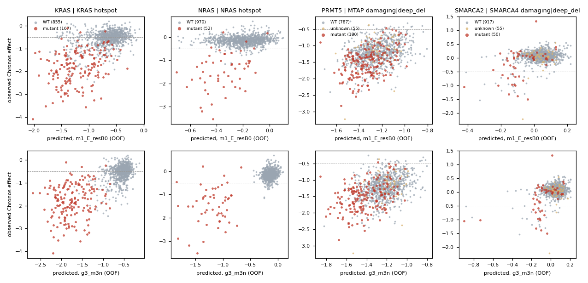

# Mutation-driven dependencies — does an expression-first model miss them? (D24)

Status: complete (2026-10-27). This is a diagnostic only. P1, δ, the selection rule, gene classes, labels and the frozen
metrics are unchanged. It uses dev CV only (configs/splits.csv cv_fold). CRISPR is read through `essml.guard`
with dev IDs.

- **Spec:** DESIGN.md §4, "Mutation-driven dependencies", and RESEARCH_TREE D24.
- **Order:** the pair file `configs/oncogene_pairs.csv` and the declared choices
  `configs/mutation_dependencies.json` were committed in 57984af, before any pair-level metric. The results
  were committed after them in 6929a0d.
- **Code:** `src/essml/mutdeps.py` (toy tests: `tests/test_mutdeps.py`) and `scripts/mutation_dependencies.py`.
- **Outputs:** `results/mutation_dependencies.json` and the fold-level metrics in
  `results/mutation_dependencies_folds.csv`.

## Answer in brief
**Partly, and only for RAS/RAF hotspot addictions. Under the pre-registered rule, genomics does not "clearly
help", so the targeted own-genomic M2 variant was not built.**

- **What the expression-only ridge misses:** NRAS-hotspot addiction. AUPRC is 0.21 for E-only against 0.60 for
  the status-only reference. To a smaller degree it also misses BRAF and KRAS.
- **What already fixes it:** the headline `m5_avg` is not expression-only, because its M3 input sees
  hotspot/CN/damaging features. It recovers most of the gap, with NRAS AUPRC at 0.63.
- **Pairs where expression already captures the dependency:** amplifications (ERBB2, CCND1, MYC, EGFR), the p53
  axis (MDM2), CTNNB1 and the collateral/paralog-loss pairs. Explicit genomics changes AUPRC for these by −0.02
  to +0.05 with the linear model and −0.01 to +0.08 with LightGBM (largest: MDM2, STAG1). None of these pairs
  reaches +0.10 consistently.

## Pair set and models
- **Eligibility:** 17 of 19 pairs are eligible (≥ 5 biomarker-positive dev lines). ENO1→ENO2 has 1 line and
  VPS4B→VPS4A has 4; both are "too few" and are excluded from pooled statistics.
- **Thresholds,** from `features.py`:
  - amplification: relative CN > 2.0;
  - deep deletion: relative CN < 0.25;
  - hotspot: hotspot matrix > 0;
  - damaging: dosage > 0;
  - TP53-WT: no TP53 damaging mutation and no TP53 hotspot.
- **Missing CN profile (55 dev lines):** the CN component is unknown for these lines. They are left out of the
  strata but kept in the all-line metrics.

The models compared, using the latest ok registry rows and their out-of-fold predictions:

| label | run | what it sees |
|---|---|---|
| E-only | m1_E_resB0 (20261026-222117) | expression |
| E+genomics | m1bt_full (20261027-002223) | E + C + M + H + F + Meta + composites, tuned block weights |
| M3 | g3_m3n (20261027-014824) | LightGBM on M1 residuals, screened E/C/M/H/lineage features |
| m5_avg | m5_avg (20261027-161041) | headline: average of M1, M2 (paralogs) and M3 |
| B1 | b1 (20261026-220921) | lineage mean |
| biomarker-only | computed here | training-fold mean effect by status (mutant / WT) |

- **How the metrics are computed:**
  - each value is the mean over the 5 outer folds of the per-fold metric on that fold's held-out lines;
  - each Δ is model − E-only, paired by fold, with a t-based 95% CI (df 4);
  - AUPRC is for effect < −0.5, using the frozen `metrics.per_gene_ap_norm`, and needs ≥ 3 dependent and
    ≥ 3 non-dependent lines in the fold;
  - "n dep" is the number of dev lines with effect < −0.5.

### Per-gene r over all lines
| Dependency | Biomarker | n mut | n dep | E-only | E+genomics | M3 | m5_avg | B1 | biomarker-only | Δ E+genomics | Δ M3 | Δ m5_avg | Δ biomarker-only |
|---|---|---|---|---|---|---|---|---|---|---|---|---|---|
| BRAF | BRAF hotspot | 72 | 91 | 0.628 | 0.664 | 0.772 | 0.708 | 0.589 | 0.737 | +0.036 [+0.003, +0.068] | +0.144 [+0.069, +0.219] | +0.080 [+0.049, +0.111] | +0.109 [-0.009, +0.228] |
| KRAS | KRAS hotspot | 167 | 569 | 0.590 | 0.640 | 0.748 | 0.700 | 0.540 | 0.726 | +0.050 [+0.016, +0.084] | +0.158 [+0.110, +0.207] | +0.110 [+0.081, +0.139] | +0.136 [+0.088, +0.185] |
| NRAS | NRAS hotspot | 52 | 76 | 0.288 | 0.442 | 0.761 | 0.612 | 0.171 | 0.769 | +0.154 [+0.044, +0.264] | +0.474 [+0.398, +0.549] | +0.325 [+0.268, +0.382] | +0.482 [+0.388, +0.576] |
| PIK3CA | PIK3CA hotspot | 103 | 350 | 0.387 | 0.436 | 0.496 | 0.465 | 0.172 | 0.410 | +0.049 [+0.015, +0.083] | +0.109 [+0.059, +0.159] | +0.078 [+0.051, +0.105] | +0.023 [-0.101, +0.147] |
| EGFR | EGFR hotspot or amp | 72 | 197 | 0.560 | 0.559 | 0.559 | 0.563 | 0.415 | 0.084 | -0.001 [-0.007, +0.004] | -0.001 [-0.008, +0.006] | +0.002 [-0.001, +0.006] | -0.476 [-0.592, -0.360] |
| ERBB2 | ERBB2 amp | 41 | 189 | 0.424 | 0.426 | 0.477 | 0.501 | 0.307 | 0.416 | +0.002 [-0.003, +0.006] | +0.053 [-0.061, +0.167] | +0.077 [-0.004, +0.158] | -0.008 [-0.164, +0.147] |
| CTNNB1 | CTNNB1 hotspot | 31 | 172 | 0.708 | 0.713 | 0.715 | 0.715 | 0.550 | 0.305 | +0.006 [-0.001, +0.013] | +0.007 [-0.023, +0.038] | +0.008 [-0.006, +0.021] | -0.402 [-0.593, -0.212] |
| CCND1 | CCND1 amp | 96 | 761 | 0.647 | 0.658 | 0.715 | 0.713 | 0.390 | 0.249 | +0.012 [+0.004, +0.019] | +0.068 [+0.037, +0.099] | +0.066 [+0.046, +0.085] | -0.398 [-0.551, -0.245] |
| MDM2 | TP53 TP53-WT | 337 | 347 | 0.685 | 0.745 | 0.799 | 0.763 | 0.401 | 0.663 | +0.060 [+0.035, +0.085] | +0.114 [+0.079, +0.149] | +0.078 [+0.055, +0.100] | -0.022 [-0.062, +0.018] |
| MYC | MYC amp | 173 | 994 | 0.532 | 0.531 | 0.584 | 0.589 | 0.348 | 0.226 | -0.001 [-0.010, +0.007] | +0.052 [+0.028, +0.076] | +0.057 [+0.039, +0.074] | -0.306 [-0.451, -0.161] |
| ARID1B | ARID1A damaging or deep_del | 116 | 40 | 0.163 | 0.172 | 0.163 | 0.163 | 0.071 | 0.316 | +0.009 [-0.015, +0.034] | +0.000 [+0.000, +0.000] | +0.000 [+0.000, +0.000] | +0.153 [+0.012, +0.295] |
| SMARCA2 | SMARCA4 damaging or deep_del | 50 | 36 | 0.386 | 0.379 | 0.431 | 0.443 | 0.119 | 0.248 | -0.008 [-0.014, -0.001] | +0.045 [-0.047, +0.137] | +0.057 [-0.044, +0.157] | -0.138 [-0.328, +0.052] |
| STAG1 | STAG2 damaging or deep_del | 22 | 66 | 0.370 | 0.369 | 0.414 | 0.514 | 0.209 | 0.390 | -0.001 [-0.008, +0.006] | +0.043 [-0.061, +0.147] | +0.144 [+0.080, +0.208] | +0.020 [-0.220, +0.259] |
| ENO2 | ENO1 damaging or deep_del (too few) | 1 | 0 | 0.177 | 0.179 | 0.177 | 0.177 | 0.099 | 0.049 | +0.002 [-0.005, +0.009] | +0.000 [+0.000, +0.000] | +0.000 [+0.000, +0.000] | -0.128 [-0.216, -0.040] |
| VPS4A | VPS4B damaging or deep_del (too few) | 4 | 264 | 0.430 | 0.439 | 0.522 | 0.503 | 0.138 | 0.010 | +0.009 [+0.005, +0.014] | +0.092 [+0.025, +0.159] | +0.073 [+0.027, +0.119] | -0.420 [-0.520, -0.319] |
| PRMT5 | MTAP damaging or deep_del | 180 | 1005 | 0.392 | 0.395 | 0.439 | 0.424 | 0.193 | 0.308 | +0.004 [-0.010, +0.018] | +0.047 [+0.003, +0.091] | +0.032 [+0.009, +0.054] | -0.084 [-0.183, +0.014] |
| MAT2A | MTAP damaging or deep_del | 180 | 974 | 0.322 | 0.325 | 0.326 | 0.344 | 0.274 | 0.097 | +0.003 [-0.007, +0.012] | +0.003 [-0.029, +0.035] | +0.022 [+0.011, +0.033] | -0.225 [-0.388, -0.062] |
| CREBBP | EP300 damaging or deep_del | 66 | 113 | 0.301 | 0.308 | 0.294 | 0.351 | 0.105 | 0.213 | +0.007 [-0.007, +0.022] | -0.007 [-0.054, +0.041] | +0.050 [-0.018, +0.118] | -0.088 [-0.256, +0.081] |
| EP300 | CREBBP damaging or deep_del | 57 | 323 | 0.516 | 0.517 | 0.508 | 0.525 | 0.401 | 0.135 | +0.001 [-0.002, +0.005] | -0.008 [-0.026, +0.011] | +0.009 [-0.003, +0.021] | -0.381 [-0.493, -0.269] |

### AUPRC over all lines
| Dependency | Biomarker | n mut | n dep | E-only | E+genomics | M3 | m5_avg | B1 | biomarker-only | Δ E+genomics | Δ M3 | Δ m5_avg | Δ biomarker-only |
|---|---|---|---|---|---|---|---|---|---|---|---|---|---|
| BRAF | BRAF hotspot | 72 | 91 | 0.558 | 0.623 | 0.732 | 0.661 | 0.441 | 0.613 | +0.065 [+0.004, +0.126] | +0.174 [+0.037, +0.312] | +0.103 [+0.020, +0.186] | +0.056 [-0.184, +0.295] |
| KRAS | KRAS hotspot | 167 | 569 | 0.756 | 0.780 | 0.818 | 0.805 | 0.723 | 0.680 | +0.024 [+0.008, +0.040] | +0.062 [+0.035, +0.088] | +0.049 [+0.037, +0.061] | -0.076 [-0.112, -0.039] |
| NRAS | NRAS hotspot | 52 | 76 | 0.212 | 0.451 | 0.657 | 0.631 | 0.129 | 0.600 | +0.239 [+0.072, +0.407] | +0.445 [+0.294, +0.596] | +0.419 [+0.297, +0.542] | +0.388 [+0.264, +0.513] |
| PIK3CA | PIK3CA hotspot | 103 | 350 | 0.597 | 0.628 | 0.640 | 0.647 | 0.435 | 0.440 | +0.031 [+0.013, +0.049] | +0.042 [-0.015, +0.100] | +0.050 [+0.024, +0.076] | -0.157 [-0.251, -0.063] |
| EGFR | EGFR hotspot or amp | 72 | 197 | 0.587 | 0.582 | 0.580 | 0.590 | 0.443 | 0.225 | -0.005 [-0.011, +0.001] | -0.007 [-0.015, +0.001] | +0.003 [-0.011, +0.018] | -0.362 [-0.426, -0.299] |
| ERBB2 | ERBB2 amp | 41 | 189 | 0.453 | 0.457 | 0.471 | 0.507 | 0.342 | 0.280 | +0.004 [-0.002, +0.010] | +0.018 [-0.055, +0.091] | +0.053 [+0.018, +0.089] | -0.173 [-0.272, -0.074] |
| CTNNB1 | CTNNB1 hotspot | 31 | 172 | 0.730 | 0.733 | 0.729 | 0.734 | 0.531 | 0.251 | +0.003 [-0.009, +0.015] | -0.001 [-0.035, +0.032] | +0.004 [-0.012, +0.019] | -0.479 [-0.624, -0.333] |
| CCND1 | CCND1 amp | 96 | 761 | 0.946 | 0.952 | 0.955 | 0.958 | 0.878 | 0.778 | +0.006 [-0.001, +0.013] | +0.009 [-0.004, +0.022] | +0.012 [+0.003, +0.020] | -0.169 [-0.205, -0.132] |
| MDM2 | TP53 TP53-WT | 337 | 347 | 0.784 | 0.831 | 0.865 | 0.847 | 0.530 | 0.649 | +0.047 [+0.038, +0.056] | +0.080 [+0.042, +0.119] | +0.063 [+0.033, +0.093] | -0.135 [-0.176, -0.094] |
| MYC | MYC amp | 173 | 994 | 0.997 | 0.997 | 0.998 | 0.997 | 0.987 | 0.975 | -0.000 [-0.001, +0.001] | +0.001 [-0.001, +0.003] | +0.000 [-0.001, +0.001] | -0.023 [-0.040, -0.006] |
| ARID1B | ARID1A damaging or deep_del | 116 | 40 | 0.180 | 0.203 | 0.180 | 0.180 | 0.056 | 0.149 | +0.023 [-0.032, +0.079] | +0.000 [+0.000, +0.000] | +0.000 [+0.000, +0.000] | -0.031 [-0.269, +0.207] |
| SMARCA2 | SMARCA4 damaging or deep_del | 50 | 36 | 0.556 | 0.535 | 0.598 | 0.631 | 0.122 | 0.145 | -0.021 [-0.047, +0.005] | +0.042 [-0.074, +0.158] | +0.075 [-0.087, +0.236] | -0.411 [-0.623, -0.199] |
| STAG1 | STAG2 damaging or deep_del | 22 | 66 | 0.338 | 0.349 | 0.413 | 0.485 | 0.188 | 0.207 | +0.011 [+0.004, +0.018] | +0.076 [+0.004, +0.148] | +0.148 [+0.077, +0.219] | -0.131 [-0.207, -0.055] |
| ENO2 | ENO1 damaging or deep_del (too few) | 1 | 0 | – | – | – | – | – | – | – | – | – | – |
| VPS4A | VPS4B damaging or deep_del (too few) | 4 | 264 | 0.506 | 0.519 | 0.552 | 0.559 | 0.328 | 0.258 | +0.013 [-0.005, +0.030] | +0.045 [-0.011, +0.102] | +0.053 [+0.017, +0.089] | -0.249 [-0.319, -0.179] |
| PRMT5 | MTAP damaging or deep_del | 180 | 1005 | 0.992 | 0.992 | 0.993 | 0.993 | 0.981 | 0.984 | +0.001 [-0.001, +0.002] | +0.001 [-0.001, +0.004] | +0.001 [-0.001, +0.003] | -0.007 [-0.016, +0.001] |
| MAT2A | MTAP damaging or deep_del | 180 | 974 | 0.974 | 0.975 | 0.976 | 0.976 | 0.978 | 0.956 | +0.001 [-0.001, +0.003] | +0.002 [-0.002, +0.005] | +0.002 [-0.001, +0.004] | -0.019 [-0.036, -0.001] |
| CREBBP | EP300 damaging or deep_del | 66 | 113 | 0.305 | 0.304 | 0.295 | 0.349 | 0.140 | 0.183 | -0.002 [-0.022, +0.019] | -0.010 [-0.062, +0.042] | +0.044 [-0.043, +0.131] | -0.122 [-0.188, -0.056] |
| EP300 | CREBBP damaging or deep_del | 57 | 323 | 0.605 | 0.606 | 0.598 | 0.606 | 0.523 | 0.341 | +0.001 [-0.001, +0.003] | -0.007 [-0.017, +0.003] | +0.001 [-0.014, +0.016] | -0.264 [-0.363, -0.165] |

- **Normalised AP:** it is in the JSON. Paired ΔnAP = ΔAP/(1 − π), so it adds no ranking information here.
- **ARID1B, SMARCA2 and ENO2** are not dev-wide variable genes. M2 and M3 pass the M1 prediction through for
  them in most folds, so for those genes Δ M3 = 0 by construction.

### Within-stratum r and biomarker discrimination
Each cell lists fold means for E-only / E+genomics / M3 / m5_avg; the number in brackets is how many folds were
defined.
- **Strata:** each stratum needs ≥ 5 observed lines per fold. Within-mutant AUPRC is mostly undefined, because
  nearly every KRAS-, MYC- or MTAP-positive line is dependent; values are in the JSON.
- **Biomarker AUROC:** among dependent lines, it is the AUROC of the prediction for separating mutant from WT.
  It needs ≥ 3 lines of each status per fold. The biomarker-only reference scores 1.0 by construction, so it is
  omitted.

| Dependency | r mutant: E-only / E+gen / M3 / m5_avg | r WT: E-only / E+gen / M3 / m5_avg | biomarker AUROC: E-only / E+gen / M3 / m5_avg |
|---|---|---|---|
| BRAF (BRAF) | 0.616 / 0.614 / 0.636 / 0.627 (5) | 0.192 / 0.193 / 0.183 / 0.197 (5) | 0.864 / 0.917 / 0.990 / 0.954 (5) |
| KRAS (KRAS) | 0.333 / 0.340 / 0.228 / 0.313 (5) | 0.327 / 0.344 / 0.408 / 0.404 (5) | 0.853 / 0.899 / 0.994 / 0.937 (5) |
| NRAS (NRAS) | 0.428 / 0.409 / 0.227 / 0.340 (5) | 0.123 / 0.128 / 0.166 / 0.149 (5) | 0.824 / 0.952 / 1.000 / 1.000 (5) |
| PIK3CA (PIK3CA) | 0.103 / 0.193 / 0.071 / 0.138 (5) | 0.409 / 0.418 / 0.388 / 0.418 (5) | 0.437 / 0.571 / 0.937 / 0.710 (5) |
| EGFR (EGFR) | 0.519 / 0.531 / 0.516 / 0.528 (5) | 0.571 / 0.568 / 0.568 / 0.572 (5) | 0.522 / 0.531 / 0.521 / 0.539 (5) |
| ERBB2 (ERBB2) | 0.400 / 0.379 / 0.349 / 0.432 (5) | 0.344 / 0.343 / 0.333 / 0.359 (5) | 0.744 / 0.759 / 0.948 / 0.933 (5) |
| CTNNB1 (CTNNB1) | 0.775 / 0.777 / 0.770 / 0.765 (3) | 0.692 / 0.695 / 0.698 / 0.699 (5) | 0.554 / 0.582 / 0.634 / 0.590 (3) |
| CCND1 (CCND1) | 0.242 / 0.245 / 0.373 / 0.345 (5) | 0.650 / 0.663 / 0.707 / 0.704 (5) | 0.588 / 0.595 / 0.767 / 0.753 (5) |
| MDM2 (TP53) | 0.613 / 0.620 / 0.663 / 0.653 (5) | 0.339 / 0.377 / 0.417 / 0.366 (5) | 0.860 / 0.935 / 0.971 / 0.931 (5) |
| MYC (MYC) | 0.328 / 0.344 / 0.399 / 0.366 (5) | 0.545 / 0.538 / 0.574 / 0.585 (5) | 0.625 / 0.628 / 0.741 / 0.740 (5) |
| ARID1B (ARID1A) | 0.199 / 0.176 / 0.199 / 0.199 (5) | 0.073 / 0.074 / 0.073 / 0.073 (5) | 0.718 / 0.760 / 0.718 / 0.718 (3) |
| SMARCA2 (SMARCA4) | 0.531 / 0.513 / 0.604 / 0.583 (5) | 0.326 / 0.319 / 0.377 / 0.391 (5) | 0.583 / 0.617 / 0.583 / 0.583 (2) |
| STAG1 (STAG2) | 0.255 / 0.249 / 0.329 / 0.493 (3) | 0.354 / 0.353 / 0.375 / 0.405 (5) | 0.749 / 0.739 / 0.849 / 0.886 (2) |
| PRMT5 (MTAP) | 0.437 / 0.440 / 0.405 / 0.440 (5) | 0.337 / 0.333 / 0.342 / 0.348 (5) | 0.648 / 0.673 / 0.790 / 0.710 (5) |
| MAT2A (MTAP) | 0.264 / 0.275 / 0.336 / 0.301 (5) | 0.343 / 0.341 / 0.334 / 0.362 (5) | 0.471 / 0.487 / 0.555 / 0.504 (5) |
| CREBBP (EP300) | 0.561 / 0.520 / 0.535 / 0.650 (5) | 0.262 / 0.270 / 0.261 / 0.271 (5) | 0.697 / 0.722 / 0.740 / 0.879 (4) |
| EP300 (CREBBP) | 0.285 / 0.282 / 0.285 / 0.344 (5) | 0.522 / 0.525 / 0.515 / 0.525 (5) | 0.562 / 0.555 / 0.567 / 0.650 (5) |

## "Genomics clearly helps" — rule outcome
The rule is DESIGN §4, made operational in `configs/mutation_dependencies.json`. AUPRC is over all lines;
each comparator is compared with m1_E_resB0.

| comparator | (1) pooled ΔAUPRC, 95% CI (fold-paired, df 4) | folds + | (2) pairs with ΔAUPRC ≥ 0.10 in ≥ 4/5 folds | met? |
|---|---|---|---|---|
| m1bt_full (E+genomics) | **+0.029 [+0.009, +0.048]**: holds | 5/5 | NRAS only (4/5); BRAF 1/5: fails | **no** |
| g3_m3n (M3) | **+0.062 [+0.051, +0.073]**: holds | 5/5 | NRAS only (5/5); BRAF 3/5, STAG2→STAG1 2/5: fails | **no** |

- **Outcome: not met.** Condition 1 holds for both comparators. Condition 2 needs 3 pairs and only one pair
  (NRAS) qualifies.
- **Comparator reading doesn't matter.** Pooling the qualifying pairs across both comparators still gives only
  NRAS, so the outcome is the same whether or not both conditions must come from one comparator.
- **Pairs in the pool:** the pooled mean uses the 15 of 17 eligible pairs whose AUPRC is defined in all 5 folds,
  as declared. MYC_amp and MTAP_PRMT5 each have one fold with fewer than 3 non-dependent lines, because almost
  every line depends on MYC and on PRMT5.
- **Pooled Δ vs E-only for the other models (same construction; descriptive):**
  - m5_avg: AUPRC +0.068 [+0.051, +0.086], r +0.070 [+0.063, +0.077], biomarker AUROC +0.114 [+0.094, +0.133];
  - biomarker-only: AUPRC −0.139 [−0.166, −0.112], r −0.095;
  - B1: AUPRC −0.142.
- **Post hoc sensitivity (descriptive, not part of the rule):** NRAS's direction was already hinted in G3 (D24
  disclosure). Without NRAS, the pooled ΔAUPRC is +0.013 [+0.003, +0.024] for m1bt_full and +0.034
  [+0.025, +0.044] for g3_m3n.

**Consequence (DESIGN §4):** the targeted M2 variant with own-genomic local features is **not** pre-registered or
run. The reason, in numbers:
- **The gain is broad but small.** All 15 pooled pairs together average +0.03 (E+genomics) to +0.06 (M3), but
  outside NRAS no pair gains ≥ 0.10 consistently. BRAF under M3 has +0.26, +0.25 and +0.25 in folds 0, 2 and 3,
  but only +0.05 in folds 1 and 4.
- **For amplification, p53-axis and loss pairs, expression already carries the signal.** The mutation drives the
  expression of the gene or of its pathway (see Mechanism).
  - E+genomics changes AUPRC by −0.02 to +0.05 for these pairs.
  - The status-only reference is worse than E-only on 13 of the 15 pooled pairs.
- **The residual hotspot signal is already in the headline.** m5_avg contains M3, which sees the hotspot calls,
  and it captures most of the gain:
  - NRAS AUPRC: 0.21 → 0.63, against 0.66 for M3 alone;
  - BRAF: 0.56 → 0.66;
  - KRAS: 0.76 → 0.81.

  So an own-genomic M2 would mostly duplicate what the average already does for these genes.

## Figure

- **What it shows:** out-of-fold prediction against observed Chronos effect for all dev lines, for the four
  pairs declared in the config before any result (KRAS, NRAS, MTAP→PRMT5, SMARCA4→SMARCA2).
- **Rows:** top is E-only (m1_E_resB0); bottom is M3 (g3_m3n).
- **Colour:** red is biomarker-positive, grey WT, yellow unknown (no CN profile).
- **The dashed line** is the −0.5 dependency threshold.
- **NRAS:** E-only compresses the hotspot lines into the WT cloud (predictions between about −0.7 and 0), while
  M3 separates them.
- **PRMT5:** under both models the MTAP-deleted lines sit at the more-dependent end.

## Mechanism (descriptive; pooled out-of-fold over dev lines)
The columns, all computed for the E-only prediction:
- **r(pred, own E):** correlation of the E-only prediction with the dependency gene's own expression;
- **r(pred, biomarker E):** correlation with the biomarker gene's expression, for paralog pairs;
- **r(pred, status):** correlation with biomarker status;
- **lineage η²:** the share of the prediction's variance explained by lineage means;
- **within-lineage r:** prediction against observed after centring both within lineage.

The table covers the four eligible pairs with the highest E-only r (CTNNB1, MDM2, CCND1, BRAF, as declared), plus
the pair that meets the gain criterion (NRAS), and KRAS and MTAP→PRMT5 for context. Full values for all models are
in `results/mutation_dependencies.json` → `mechanism`.

| pair | E-only r | r(pred, own E) | r(pred, biomarker E) | r(pred, status) | lineage η² | within-lineage r (E-only → M3) | reading |
|---|---|---|---|---|---|---|---|
| CTNNB1 / CTNNB1 hotspot | 0.71 | −0.17 | — | −0.23 | 0.66 | 0.48 → 0.51 | lineage (colorectal/Wnt) plus a within-lineage programme, not the hotspot |
| MDM2 / TP53-WT | 0.69 | −0.42 | TP53 −0.11 | −0.57 | 0.41 | 0.58 → 0.75 | own expression: MDM2 is a p53 target, so its mRNA reads out TP53 status (r(status, MDM2 E) = +0.51) |
| CCND1 / CCND1 amp | 0.65 | −0.63 | — | −0.19 | 0.47 | 0.55 → 0.64 | own expression: amplification raises CCND1 mRNA |
| BRAF / BRAF hotspot | 0.63 | −0.10 | — | −0.59 | 0.65 | 0.32 → 0.57 | lineage (melanoma); status within lineage is missed |
| KRAS / KRAS hotspot | 0.59 | −0.21 | — | −0.56 | 0.60 | 0.33 → 0.61 | lineage (pancreas, colorectal) plus a RAS programme; status within lineage is missed |
| NRAS / NRAS hotspot | 0.29 | −0.20 | — | −0.24 | 0.33 | 0.19 → 0.73 | something else, weakly: the hotspot has no expression proxy, so E-only misses it |
| PRMT5 / MTAP loss | 0.39 | −0.01 | MTAP +0.20 | −0.21 | 0.29 | 0.32 → 0.38 | MTAP expression is a proxy for the deletion (r(status, MTAP E) = −0.84), but ridge uses it only weakly |

(The r column is the pooled out-of-fold r; the fold-mean r in the tables above differs by ≤ 0.02.)

**Reading.**
- **Amplification and the p53 axis:** expression-only prediction works through the gene's own expression.
  ERBB2, EGFR and MYC give r(pred, own E) of −0.40 to −0.56.
- **RAS/RAF hotspots:** it works mainly through lineage, η² 0.6–0.65 for BRAF and KRAS. The point mutation
  inside a lineage is invisible to expression, and tree-based genomics recovers it: within-lineage r rises by
  0.25–0.55.
- **Paralog and collateral loss:** the E-only signal is moderate (r 0.16–0.52). Status-only does no better,
  except ARID1B, where it reaches 0.32 vs 0.16 in r but not in AUPRC.

## Caveats
- **Strata:** within-mutant metrics rest on few lines per fold (e.g. STAG2 22 lines in total, CTNNB1 31). Several
  are undefined in some folds; the defined-fold counts are given above.
- **Unknown TP53 status:** `TP53-WT` treats a line without mutation data as unknown, whereas
  `build_composites` would treat it as WT. No dev line is affected.
- **VPS4B→VPS4A:** DESIGN §4 sets the direction as VPS4B loss → VPS4A. configs/biomarker_pairs.csv (D22) lists
  the reverse. Both are too few here to test.
- **Independent review:** a reviewer who did not write the code recomputed every fold metric, the pooled CI and
  the rule from the cached predictions with their own code, and all matched to within 5e-7. They also confirmed:
  - the strata and the biomarker-only reference use training-fold information only;
  - the pair-file commit precedes the results commit, and the pair file is unchanged since.

  Their minor findings were acted on or disclosed here:
  - the pair-level n now sums over folds;
  - the 15-of-17 pooled set is stated;
  - the rule's comparator wording is discussed;
  - the TP53 unknown convention is disclosed.

## Conclusion (plain language)
- **Overall:** an expression-first model does not broadly miss mutation-driven dependencies.
- **Where expression already tells the story:** when the mutation changes how much of a gene is made
  (amplified ERBB2, CCND1 or MYC; MDM2 in TP53-normal cells; most paralog-loss pairs).
- **The blind spot:** the RAS/RAF hotspot addictions, and NRAS most of all. A single-letter change in NRAS
  leaves its mRNA unchanged, so the ridge model cannot see it. Within a lineage, it cannot tell mutant from
  WT lines.
- **The headline already covers it.** The headline `m5_avg` includes a LightGBM component that sees the
  mutation calls, and it closes most of this gap: NRAS AUPRC rises from 0.21 to 0.63.
- **Rule outcome:** the pre-registered "clearly helps" bar asks for a broad gain (three or more pairs with a
  large, consistent improvement). Only one pair clears it, so no extra genomic model was built.
