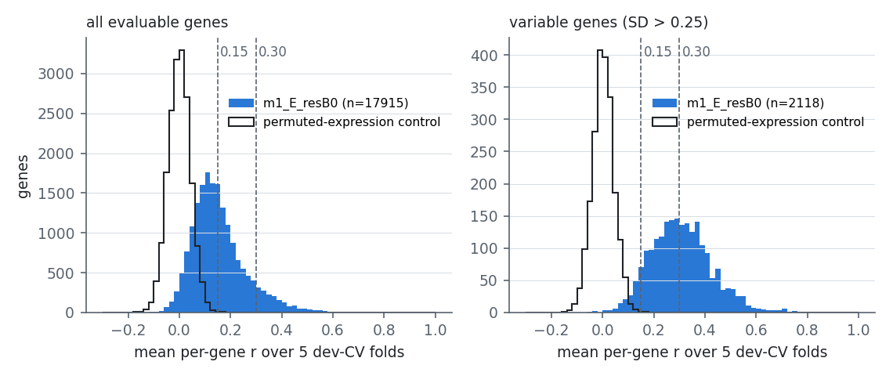
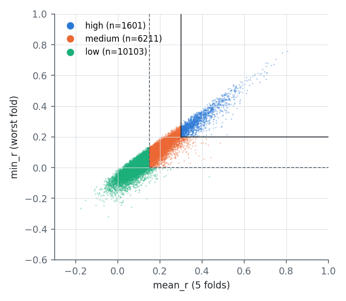

# Per-gene predictability: tiers, confidence score and characterisation (D22)

This is a diagnostic, pre-registered in DESIGN §4 ("Per-gene predictability") and RESEARCH_TREE D22. It does
not change the headline metric (P1 on variable genes), the selection rule, δ, the gene classes, the labels or
the metrics.

The tier source is the G4 headline `m5_avg` (CV run 20261027-161041; D23f). The expression-only `m1_E_resB0`
(run 20261026-222117) is kept as a secondary table. `scripts/predict.py` serves m5_avg by default (primary
tiers) and m1_E_resB0 on request (its own secondary tiers). predict.py reads expression only, so its m5_avg runs
without genomics. That use was evaluated only post hoc, in dev CV (§7; docs/predict_expression_only.md).

Methods were declared in `configs/predictability.json`, and the literature list in `configs/biomarker_pairs.csv`,
both committed in 278f156 before any tier was computed. Every number below is from the committed outputs:
- `configs/predictable_genes.csv` (frozen, primary) and `configs/predictable_genes_m1.csv` (secondary);
- `results/predictability/distribution.json` (m5_avg) and `distribution_m1.json`;
- `results/predictability/characterisation.json`, `biomarker_pairs.csv`, `enrichment.csv` and `gene_properties.csv.gz`;
- `results/dryrun/test/*/summary.json` (step `per_tier`).

Scripts: `scripts/predictability_tiers.py`, `scripts/predictability_characterise.py`, `scripts/predict.py`,
`src/essml/predictability.py`.

## 1. Definitions (as pre-registered)

- **Per-fold r.** For each gene and outer dev-CV fold, r_g,k is the frozen `essml.evaluate` per-gene Pearson r
  across the fold's held-out lines.
  - The gene is evaluable in a fold under evaluate's min_obs rule (≥ 40 observed held-out lines).
  - The recomputed r reproduces each run's cached evaluation: max |diff| 1.8e-7, because predictions are
    stored as float32.
- **Fold statistics.** mean_r, min_r, and sd_r (fold SD, ddof 1).
- **Tiers.** A gene not evaluable in all 5 folds is **not_evaluable**. Otherwise:
  - **high**: mean_r ≥ 0.30 and min_r ≥ 0.20;
  - **medium**: not high, mean_r ≥ 0.15 and min_r > 0;
  - **low**: every other evaluable gene.
- **Confidence** = clip(mean_r − sd_r, −1, 1); NaN if not evaluable.
- **Null calibration.** The same tiers are computed on the permuted-expression control `ctl_resB0_permuted`.
  - If null-high > 5% of observed-high, T_high is raised to the smallest of {0.35, 0.40, 0.50} that passes.

## 2. Tier counts and null FDR

| | high | medium | low | not evaluable |
|---|---:|---:|---:|---:|
| **m5_avg, all 18,434 genes (frozen)** | **1,632** | 6,198 | 10,085 | 519 |
| m5_avg, variable genes (2,159) | 1,054 | 921 | 143 | 41 |
| m5_avg, selective | 1,075 | 1,237 | 260 | 38 |
| m5_avg, rare-selective | 233 | 1,405 | 1,353 | 86 |
| m5_avg, common essential | 240 | 494 | 105 | 9 |
| m5_avg, non-essential (NEGv1) | 9 | 215 | 580 | 21 |
| permuted control (null), all genes | 0 | 10 | 17,905 | 519 |
| m1_E_resB0 (secondary), all genes | 1,601 | 6,211 | 10,103 | 519 |

**Null calibration: not triggered. Threshold used: T_high = 0.30. Estimated FDR of "high" = 0/1,632 = 0.**

| T_high | 0.30 | 0.35 | 0.40 | 0.50 |
|---|---:|---:|---:|---:|
| observed high (m5_avg) | 1,632 | 1,058 | 602 | 199 |
| null high | 0 | 0 | 0 | 0 |

- For medium, null/observed = 10/6,198 = 0.16%.
- The null's mean_r on variable genes lies in [−0.067, 0.074] (5–95%), with a 99th percentile of 0.098.
- So the null cannot reach the high tier at all. The binding requirement is the min_r ≥ 0.20 rule plus a
  mean of 0.30, far above anything the permuted control produces.
- Caveat: the null is an M1-path control (DESIGN fixes it). M3's genomic inputs have no matched expression null.

**m1 vs m5 tiers.** The two tables agree on 18,345 of 18,434 genes:
- 1,587 genes are high in both;
- 45 are high for m5 but medium for m1;
- 14 are high for m1 but medium for m5.

85 of the 89 changes are in variable genes, because M2 and M3 act only on genes that are variable in the
training fold.

## 3. Distribution of per-gene mean_r (m5_avg)




| quantile | 1% | 5% | 10% | 25% | 50% | 75% | 90% | 95% | 99% |
|---|---:|---:|---:|---:|---:|---:|---:|---:|---:|
| all evaluable (17,915) | −0.027 | 0.017 | 0.041 | 0.084 | 0.137 | 0.205 | 0.298 | 0.367 | 0.507 |
| variable (2,118 evaluable) | 0.072 | 0.141 | 0.167 | 0.230 | 0.306 | 0.389 | 0.482 | 0.540 | 0.697 |
| null, variable | −0.095 | −0.067 | −0.050 | −0.025 | 0.002 | 0.030 | 0.057 | 0.074 | 0.098 |

- **Fraction with mean_r ≥ 0.3:** 51.8% of variable genes and 9.8% of all evaluable genes.
- **Fraction with mean_r ≥ 0.2:** 83.0% of variable genes and 26.3% of all evaluable genes (m1: 81.6% / 26.1%).
- For m1, 50.3% of variable genes have mean_r ≥ 0.3.
- **Median mean_r by tier:** high 0.373 (IQR 0.334–0.433), medium 0.199, low 0.090.
- **Median confidence by tier:** high 0.314, medium 0.137, low 0.026.

**Per-gene P2b by tier** (dev CV, selective genes; per gene the mean over folds of the frozen evaluate's nAP and
AUROC):

| tier | n (prev ≤ 0.5 in every fold) | mean nAP | mean AUROC | n (all selective) | mean nAP | mean AUROC |
|---|---:|---:|---:|---:|---:|---:|
| high | 637 | 0.306 | 0.735 | 1,075 | 0.371 | 0.723 |
| medium | 843 | 0.138 | 0.634 | 1,237 | 0.186 | 0.630 |
| low | 223 | 0.066 | 0.567 | 260 | 0.082 | 0.567 |

## 4. Characterisation (dev only)

- **Data access.** CRISPR values were read only through `essml.guard.load_targets` with the 1,022 dev IDs.
  External anchor profiles were read through `guard.load_harmonised(anchor_model_id=<dev line>)`, for the 23
  screens of 18 dev anchor lines; each read is logged in `results/test_access_log.csv`.
- **Effect sizes.** High vs low: median difference with a 2,000-resample gene bootstrap 95% CI, and the
  rank-biserial correlation.
- **Association with mean_r.** Spearman ρ with mean_r across all 17,915 evaluable genes, with a gene-bootstrap CI.
- Genes are not independent, so the p-values and CIs are descriptive.

### Continuous properties (median by tier)

| property | high | medium | low | high − low (95% CI) | rank-biserial | ρ with mean_r (95% CI) |
|---|---:|---:|---:|---|---:|---|
| gene-effect SD (dev) | 0.286 | 0.152 | 0.133 | 0.154 (0.148, 0.160) | 0.93 | 0.51 (0.50, 0.52) |
| gene-effect mean | −0.400 | −0.080 | −0.002 | −0.398 (−0.427, −0.370) | −0.80 | −0.46 (−0.48, −0.45) |
| fraction of lines < −0.5 | 0.306 | 0.011 | 0.003 | 0.303 (0.271, 0.339) | 0.90 | 0.51 (0.49, 0.52) |
| cross-library reliability, groups 0 vs 1 (10 lineages) | 0.512 | 0.319 | 0.189 | 0.323 (0.303, 0.343) | 0.48 | 0.27 (0.26, 0.29) |
| … variable genes only | 0.525 | 0.324 | 0.189 | 0.336 (0.260, 0.410) | 0.51 | 0.36 (0.32, 0.39) |
| cross-library reliability, groups 0 vs 2 (7 lineages) | 0.324 | 0.102 | 0.011 | 0.313 (0.276, 0.354) | 0.31 | 0.15 (0.14, 0.17) |
| agreement with external dev-anchor screens (23 screens) | 0.306 | 0.129 | 0.041 | 0.266 (0.248, 0.283) | 0.52 | 0.27 (0.25, 0.28) |
| … variable genes only | 0.310 | 0.158 | 0.048 | 0.262 (0.213, 0.309) | 0.54 | 0.36 (0.32, 0.40) |
| own expression vs own effect, signed r | −0.011 | −0.011 | −0.009 | −0.001 (−0.009, 0.007) | −0.02 | −0.02 (−0.03, 0.00) |
| own expression vs own effect, \|r\| | 0.078 | 0.046 | 0.032 | 0.046 (0.041, 0.051) | 0.49 | 0.29 (0.28, 0.30) |
| mean own expression, log2(TPM+1) | 4.91 | 3.47 | 1.51 | 3.40 (3.27, 3.53) | 0.70 | 0.37 (0.36, 0.38) |
| max paralog identity (%) | 27.7 | 35.7 | 41.6 | −14.0 (−15.8, −11.6) | −0.19 | −0.11 (−0.12, −0.09) |

All Kruskal–Wallis p < 1e-25, except signed own-expression r (p = 0.26).

### Binary properties (fraction per tier; odds ratio high vs low, Woolf 95% CI, Fisher p)

| property | high | medium | low | OR high vs low (95% CI) | p |
|---|---:|---:|---:|---|---|
| variable | 0.646 | 0.149 | 0.014 | 127 (104, 154) | < 1e-300 |
| selective | 0.659 | 0.200 | 0.026 | 73 (62, 86) | < 1e-300 |
| rare-selective | 0.143 | 0.227 | 0.134 | 1.07 (0.93, 1.25) | 0.3 |
| common essential | 0.147 | 0.080 | 0.010 | 16.4 (12.9, 20.8) | 3e-128 |
| non-essential (NEGv1) | 0.006 | 0.035 | 0.058 | 0.09 (0.05, 0.18) | 2e-27 |
| has a paralog (≥ 20% identity) | 0.617 | 0.719 | 0.800 | 0.40 (0.36, 0.45) | 8e-55 |
| … variable genes only | 0.583 | 0.497 | 0.517 | 1.30 (0.92, 1.85) | 0.1 |
| high-identity paralog (≥ 50%) | 0.299 | 0.319 | 0.371 | 0.72 (0.64, 0.81) | 1e-8 |

**Reading.** Predictability is mostly a property of how much a gene varies across lines.
- High-tier genes have twice the effect SD of low-tier genes, and 65% are variable vs 1.4%.
- High-tier genes are measured more reproducibly:
  - DepMap lineage means agree across library groups (median r 0.51 vs 0.19);
  - external screens of the same dev lines agree with DepMap (0.31 vs 0.04).
- Both reliability effects hold within variable genes, so they are not only a by-product of variance. Low-tier
  genes are partly noise-limited, so the ceiling for any model is low there.
- The paralog depletion in the high tier disappears within variable genes (OR 1.30, CI includes 1). It reflects
  that paralog-buffered genes rarely vary, not that paralogs make variation unpredictable.
- Own-expression association is weak for all tiers (median |r| 0.08 even for high). Predictability does not
  mainly come from simple own-expression addiction.

### Known biomarker–dependency pairs (list committed before the comparison)

43 literature pairs. The m5_avg tiers are **high 33, medium 7, low 3**.
- Input labels: `m1_E_resB0_input` is the committed column, written for the expression-only model.
  `m5_avg_input` is a post-hoc amendment after review: M3 screens C/M/H/meta features on variable genes, so
  `available_to_M3` means the biomarker type is an M3 input *and* the dependency gene is variable.
- Because variable genes dominate the high tier, "available_to_M3 → high" (23/23) is partly circular. Read it as
  description.

| pair | dependency | m1 input | m5 input | m5 tier | mean_r | min_r | m1 tier (mean_r) |
|---|---|---|---|---|---:|---:|---|
| KRAS mutation | KRAS | no | M3 | high | 0.700 | 0.665 | high (0.590) |
| NRAS mutation | NRAS | no | M3 | high | 0.612 | 0.559 | **medium (0.288)** |
| BRAF V600 | BRAF | no | M3 | high | 0.708 | 0.664 | high (0.628) |
| PIK3CA hotspot | PIK3CA | no | M3 | high | 0.465 | 0.391 | high (0.387) |
| CTNNB1 activating | CTNNB1 | no | M3 | high | 0.715 | 0.624 | high (0.708) |
| EGFR mut/amp | EGFR | proxy | M3 | high | 0.563 | 0.500 | high (0.560) |
| ERBB2 amp | ERBB2 | direct | M3 | high | 0.501 | 0.372 | high (0.424) |
| MYCN amp | MYCN | direct | direct | high | 0.333 | 0.253 | high |
| ER+ | ESR1 | direct | direct | medium | 0.261 | 0.153 | medium |
| ALK mut/fusion | ALK | proxy | proxy | **low** | 0.170 | −0.005 | low |
| EWSR1-FLI1 | FLI1 | proxy | proxy | medium | 0.494 | 0.170 | medium |
| BCR-ABL1 | ABL1 | no | no | high | 0.395 | 0.247 | high |
| MTAP deletion | PRMT5 | proxy | M3 | high | 0.424 | 0.359 | high |
| MTAP deletion | MAT2A | proxy | M3 | high | 0.344 | 0.275 | high |
| ENO1 deletion | ENO2 | proxy | proxy | medium | 0.177 | 0.109 | medium |
| ME2 deletion | ME3 | proxy | proxy | **low** | 0.087 | −0.065 | low |
| MSI | WRN | proxy | proxy | high | 0.578 | 0.454 | high (0.509) |
| SMARCA4 loss | SMARCA2 | proxy | proxy | high | 0.443 | 0.356 | high |
| ARID1A loss | ARID1B | no | no | medium | 0.163 | 0.068 | medium |
| STAG2 loss | STAG1 | proxy | M3 | high | 0.514 | 0.447 | high (0.370) |
| VPS4A loss | VPS4B | proxy | M3 | high | 0.496 | 0.382 | high |
| PTEN loss | PIK3CB | proxy | proxy | medium | 0.236 | 0.116 | medium |
| TP53 WT | MDM2 / MDM4 / PPM1D | proxy | M3 | high | 0.763 / 0.613 / 0.597 | ≥ 0.49 | high |
| melanoma | SOX10 / MITF | proxy | M3 / proxy | high | 0.824 / 0.555 | ≥ 0.42 | high |
| AML | MYB / SPI1 / RUNX1 | proxy | M3 / proxy / M3 | high | 0.761 / 0.528 / 0.548 | ≥ 0.32 | high |
| AML | CEBPA | proxy | proxy | medium | 0.416 | 0.156 | medium |
| ovarian / kidney | PAX8 | proxy | M3 | high | 0.805 | 0.772 | high |
| myeloma | IRF4 | proxy | M3 | high | 0.723 | 0.642 | high |
| luminal breast | GATA3 / FOXA1 | proxy | M3 | high | 0.550 / 0.592 | ≥ 0.48 | high |
| prostate | AR | proxy | proxy | **low** | 0.139 | 0.089 | low |
| SCLC | ASCL1 | proxy | proxy | high | 0.433 | 0.253 | high |
| neuroblastoma | PHOX2B / HAND2 | proxy | proxy | high | 0.328 / 0.418 | ≥ 0.25 | high |
| lung adeno | NKX2-1 | proxy | proxy | medium | 0.354 | 0.140 | medium |
| squamous | SOX2 / TP63 | proxy | M3 | high | 0.552 / 0.748 | ≥ 0.49 | high |
| rhabdomyosarcoma | MYOD1 | proxy | proxy | high | 0.487 | 0.442 | high |

Full table with citations and per-fold r: `results/predictability/biomarker_pairs.csv`.

- The three **low** pairs are rare dependencies in DepMap (ALK, ME3, AR: ≤ 0.6% of lines < −0.5). There is too
  little variation for r to be stable across folds: min_r is ≤ 0.09.
- Several **medium** pairs are high on average but fail min_r ≥ 0.20 in one fold, because the dependent lines are
  concentrated in few folds: FLI1 (Ewing), CEBPA, NKX2-1.
- Mutation-only biomarkers (KRAS, BRAF, CTNNB1, BCR-ABL1) are predictable across lines even for the
  expression-only m1, via lineage and expression programs. Within lineages, m1 misses RAS/RAF hotspot addiction
  (D24, docs/mutation_dependencies.md); see the predict.py note in §7.

### Pathway enrichment

The test is hypergeometric, with BH correction within each collection × test, on sets of 10–500 genes in the
background. Reactome symbols map to Entrez for 97.7% of entries.

**High tier vs all evaluable genes** (1,632 / 17,915):
- **Hallmark: 22 of 50 sets at q < 0.05.**
  - E2F targets: 66/198, 3.7×, q 7e-20.
  - Oxidative phosphorylation: 62/198, 3.4×, q 2e-17.
  - G2M checkpoint: 60/196, 3.4×, q 2e-16.
  - MYC targets V1: 57/199, 3.1×, q 2e-14.
  - mTORC1 signalling: 2.9×, q 3e-12.
  - PI3K/AKT/mTOR: 3.6×, q 2e-10.
  - Mitotic spindle: 2.7×, q 1e-9.
- **Reactome: 921 of 1,724 sets.**
  - Cell Cycle, Mitotic: 159/500, 3.5×, q 2e-44.
  - Translation: 123/346, 3.9×, q 9e-40.
  - Cell Cycle Checkpoints: 4.1×, q 5e-33.
  - M Phase: 3.2×.
  - RHO GTPase Effectors: 3.4×.
  - Transcriptional Regulation by TP53: 3.1×, q 1e-22.
  - Mitochondrial translation elongation/initiation: 5.7×.

These are the variably-essential housekeeping programs: proliferation, translation, mitochondria and p53. They
reflect which genes vary in effect (common-essential and selective genes), not a pathway the model knows
specially.

**Low tier among variable genes** (143 / 2,118): no Hallmark or Reactome set at q < 0.05. The best is Reactome
"Metabolism of RNA" (48/492, 1.4×, q 0.52). Unpredictable variable genes have no shared pathway signature.

## 5. G4 dry run on dev (per-tier reporting)

`python scripts/evaluate_test.py --dry-run-dev --finalists configs/finalists.example.json --threads 4`

**Setup.** Dev fold 0 (208 lines) stands in for the test set. Every finalist is refit on folds 1–4 (814 lines),
and no non-dev ID is requested.

**Tiers in the dry run.** These are computed from m5_avg's dev-CV **folds 1–4 only**
(`results/dryrun/predictability/predictable_genes_excl_fold0.csv`: table_role dry_run, r_fold0 dropped; high
1,695 / medium 6,210 / low 10,010). So the stand-in lines' own CV results are not used.
- Disclosure: the fold 1–4 CV models were trained on fold-0 lines (among others).
- The dry-run finalists file has `m1_E_resB0` as its headline, so the per-tier numbers below score m1 (and the
  others) against m5_avg tiers. The real G4 will do the same with the frozen table.
- P1 variable of the stand-in is 0.3129, equal to the CV fold-0 value.

**m1_E_resB0, patient-bootstrap 95% CIs** (2,000 resamples):

| tier | n genes | P1 (95% CI) | P1, variable genes of the tier | P2b nAP, selective prev ≤ 0.5 (n; 95% CI) | AUROC | ΔP1 vs B1 |
|---|---:|---|---|---|---:|---:|
| high | 1,695 | 0.379 (0.359, 0.394) | 0.400 (0.380, 0.416), n 1,063 | 0.299 (684; 0.284, 0.314) | 0.732 | +0.149 |
| medium | 6,210 | 0.194 (0.181, 0.206) | 0.241 (0.226, 0.254), n 904 | 0.141 (833; 0.131, 0.150) | 0.637 | +0.085 |
| low | 10,010 | 0.093 (0.084, 0.102) | 0.134 (0.120, 0.147), n 151 | 0.077 (237; 0.067, 0.087) | 0.582 | +0.035 |

**Comparators.** B1 per tier: high 0.230, medium 0.110, low 0.058. B2: 0.321, 0.156 and 0.072. B0: 0 by construction.

**Does the confidence score transfer?** Spearman ρ across genes between the dev mean_r (folds 1–4) and the
stand-in r_g:

| | n | ρ (m1) | ρ (T) | ρ (B2) | ρ (B1) |
|---|---:|---:|---:|---:|---:|
| all evaluable genes | 17,915 | **0.698** (0.669, 0.727) | 0.697 | 0.613 | 0.472 |
| variable genes | 2,118 | **0.819** (0.790, 0.848) | 0.818 | 0.729 | 0.633 |

- The dev-CV mean_r ranks genes by how well they are predicted on unseen lines: ρ 0.70 overall and 0.82 on
  variable genes. The confidence score is expected to transfer, if the test set behaves like a dev fold.
- The CI is the normal interval (point ± 1.96 × bootstrap SE), as for P2b (D21b). Resampling duplicates lines,
  which adds noise to every r_g and pulls the replicate ρ down (bias −0.097): the percentile interval
  (0.569, 0.627) excludes the point 0.698.
- The percentile interval and the bias are reported in the summary.

## 6. Confidence in every prediction output

- `modelstore.predict_new`: by default it returns a tidy table (ModelID, entrez, symbol, predicted_effect,
  confidence, tier).
  - The tier table follows the run's model (`predictability.table_for_run`).
  - `output="wide"` gives the internal matrix.
- `scripts/evaluate_test.py` (G4):
  - It refuses to start unless `configs/predictable_genes.csv` is committed, unmodified, table_role primary,
    built from all 5 folds and, when finalists.json names the headline's `cv_run_id`, built from that run.
  - The table's sha256 goes into the preflight, the predictions manifest, every finalist summary and the
    combined summary. The table must not change between preflight and evaluation.
  - `per_gene.csv.gz` carries `confidence`, `tier` and `mean_r_dev_cv`.
  - Phase A writes `<finalist>_with_confidence.parquet`.
- `scripts/evaluate_transfer.py` (G6) writes `predictions_with_confidence_<stage>_<ts>.parquet`, covering every
  model prediction made, with its sha256 in the summary.
  - For T and the other non-headline roles, the tier describes how predictable the gene's variation is in cancer
    lines. It is not a property of the external screen.

## 7. `scripts/predict.py` (users)

```
python scripts/predict.py --expression my_lines.csv --out preds.csv [--harmonise quantile] [--save-models]
```

- **Input:** log2(TPM+1) on DepMap protein-coding genes; columns are Entrez IDs or "SYMBOL (ENTREZ)".
  External profiles should use `--harmonise quantile` (the frozen D9 choice).
- **Model:** `--model m5_avg` (default; tiers configs/predictable_genes.csv) or `--model m1_E_resB0` (tiers
  configs/predictable_genes_m1.csv). Either is fitted on the dev lines (m1_E_resB0 about 90 s at 4 threads; m5_avg
  refits its three inputs, see results/timing/refit_full_dev.json), or loaded if persisted with `--save-models`.
  `--run-id` averages a CV run's persisted fold models.
- **Missing genomics (m5_avg):** only expression is read, so M2/M3's copy-number, mutation, hotspot and fusion
  inputs are diploid wild type and metadata unknown (DESIGN §2 convention). A warning says so, and `note` flags
  NRAS/KRAS/BRAF/PIK3CA: mutation-driven dependencies (D24) then rely on expression alone.
- **Evaluation of the default as shipped:** m5_avg with expression only was evaluated only post hoc, in dev CV
  (G7; docs/predict_expression_only.md, results/predict_expression_only_cv.json). The G4 test number (0.319) used
  real genomics.
  - P1 on variable genes is 0.3135, vs 0.3081 for m1_E_resB0 and 0.3175 for m5_avg with genomics.
  - The paired difference vs m1_E_resB0 is +0.0054 (SE 0.0001).
  - The PI's rule, fixed before the number was seen, was ΔP1 > δ = 0.005 and > 1 SE. It is met, narrowly, so
    m5_avg stays the default.
  - `--model m1_E_resB0` is the evaluated expression-only finalist (test P1 0.310).
- **Output:** sample, entrez, symbol, predicted_effect, confidence, tier (from the model's own table:
  `configs/predictable_genes.csv` for m5_avg, `configs/predictable_genes_m1.csv` for m1_E_resB0), the
  applicability-domain distance (mean 1 − r to the 10 nearest dev lines on the top-5,000 variable genes) and its
  percentile among dev lines, nearest_lineage, and note.
- **Mutation note:** for NRAS, KRAS, BRAF and PIK3CA, `note` flags a mutation-driven dependency that is
  underpredicted by both expression-only configurations, with a one-line warning (D24). In dev CV, NRAS AUPRC is
  0.21 for m1_E_resB0 and 0.22 for m5_avg without genomics, against 0.63 for m5_avg with genomics. Giving genomics
  to predict.py is future work. The tiers are unchanged.
- **Not produced:**
  - P(effect < −0.5): no calibrated probability exists in the code.
  - Genomic inputs for m5_avg (expression only; see "Missing genomics" and "Evaluation of the default as
    shipped").
- **Smoke test** (`results/predictability/predict_smoke_A375.json`): A375 (ACH-000219, a dev line) was held out of
  training and predicted from its own DepMap expression.
  - Applicability-domain distance 0.152, at the 10th percentile of dev lines; 9 of the 10 nearest lines are
    skin lines.
  - Correlation with the line's CV out-of-fold prediction: 0.997.
  - Per-line r vs observed: 0.963.
  - Correlation of deviations from the gene mean, by tier: high 0.64, medium 0.41, low 0.23.
  - BRAF predicted −0.75 (observed −1.35); SOX10 −1.31 (−1.82).
  - Descriptive only: the tier table includes A375's own CV fold.

## 8. How to use the confidence score

Each predicted gene effect comes with a **tier** and a **confidence** number.
- They describe how well the model ranked cell lines for *that gene* when it was tested on cancer lines it had
  not seen. They describe the gene across many lines, not your particular sample.
- **High** genes (about 1,600; mostly genes whose essentiality varies between lines) were predicted well in every
  test fold (correlation ≥ 0.2 in the worst fold, ≥ 0.3 on average). Their predicted differences between lines are
  worth acting on.
- **Medium** genes carry a useful but weaker signal. Use them to prioritise, not to decide.
- **Low** genes are mostly genes whose effect barely varies between lines, or varies inconsistently across
  screens. Their prediction is essentially the average cancer line. Use it as "typical effect", not as a
  statement about your line.
- `confidence` (mean minus fold-to-fold SD of the test correlation) orders genes within and across tiers.
- Also check `ad_distance`. If your sample is far from every DepMap line (a high percentile), all predictions are
  less certain, whatever the tier.
- The scores come from cancer cell lines. For non-transformed cells they are an upper bound on reliability
  (DESIGN §7).

## 9. Deviations and disclosures

- **Tier source changed** from m1_E_resB0 to m5_avg after G3 closed (D23f). The m1 tiers and their
  characterisation had already been computed and seen. Thresholds and rules were unchanged (RESEARCH_TREE D22b).
- **Reproduction tolerance** raised from 1e-9 to 1e-6 before any tier was written, because predictions are
  stored as float32.
- **Biomarker input labels** amended post hoc for m5_avg (D22c). The pair list is unchanged.
- **Spearman CI** uses the normal interval, because of the duplicate-line bias found in the dry run.
- **Null:** `ctl_resB0_permuted` (fixed by DESIGN) does not cover M3's genomic features.
- **Characterisation statistics** treat genes as independent, so they are descriptive. The 23 anchor screens come
  from 18 lines (5 lines screened twice).
- **Access log:** each characterisation run appends 23 dev-anchor `anchor_profile` rows to the tracked access
  log; these are committed separately.
